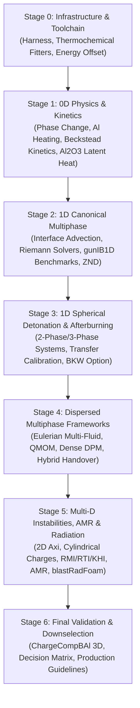

# Master Development Plan: Multiphase Aluminized Detonation & Afterburning Modelling

## 1. Executive Summary & Objective

This master development plan establishes a rigorous, staged program to extend `blastFoam` (OpenFOAM-12) for high-fidelity modelling of aluminized explosive detonation, product expansion, dynamic phase change, aluminium particle dispersion/ignition, and atmospheric afterburning.

- **Ideal Detonation Solver (external)**: The `EuDetCode` C++ library and solver suite is a separate git checkout at `external/eudetcode`, **not tracked by this repository** (neither a submodule nor ignored). The tooling uses its build there: `bin/run_blast_tests.py` Tier 0 (GoogleTest binary `build/tests/eudetcode_tests`; built, 169/169 on 2026-10-13), `tests/1D/verify_planar_znd*.py` (`build/src/DetonationStructure`, `znd_profile.dat`) and `utilities/thermo_fitter/fit_ejwlc_nobleabel.py`. (Until 2026-10-10 these scripts pointed at a non-existent `modules/eudetcode`.) It provides CJ detonation calculations (`CJDetonation`), steady 1D planar ZND / Wood-Kirkwood curved detonation structure (`DetonationStructure`), Hugoniot curves (`HugoniotCurve`), isentropic expansion evaluations, multiple mixture equations of state (THEOSTAR/Exp-6, BKW, JCZ3), and automated JWL fitting with inert phase constraints. It is coupled into the verification and regression toolchains through the paths above.

The plan operationalizes the conceptual roadmap outlined in [`report/plan.txt`](file:///opt/OpenFOAM/blastfoam/report/plan.txt) and builds directly upon the theoretical foundations established in [`report/TBX-blastFoam.tex`](file:///opt/OpenFOAM/blastfoam/report/TBX-blastFoam.tex).



---

## 2. Stage Breakdown & Document Structure

The project is structured into seven dedicated, sequentially executed stages. Each stage is documented in its own detailed action plan. The **Status** column reflects the evidence in the repository on 2026-10-14; see Section 7 and [`status_review_2026-10-14.md`](file:///opt/OpenFOAM/blastfoam/report/status_review_2026-10-14.md) (review against the report aims, with the forward plan).

| Document | Stage Title | Core Focus | Key Deliverables | Status (2026-10-19) |
|---|---|---|---|---|
| [**`stage0_infrastructure_toolchain.md`**](file:///opt/OpenFOAM/blastfoam/report/stage0_infrastructure_toolchain.md) | **Stage 0: Infrastructure & Toolchain** | Automated verification harness, regression testing, `EuDetCode`/`CHEETAH` fitters | Test harness, thermo fitter, EuDetCode coupling | **Partial.** Harness and fitter exist. EuDetCode is a separate checkout (`external/eudetcode`); Tier 0 passes (169/169, 2026-10-13). The case fits were regenerated with the current EuDetCode on 2026-10-13 (D = 7154 m/s, products-only, `utilities/thermo_fitter/products_only_fit.py`). WP 0.3 (BKW/exp-6 tabulation) and the per-step conservation monitor / norms are not implemented. |
| [**`stage1_0d_unit_physics_kinetics.md`**](file:///opt/OpenFOAM/blastfoam/report/stage1_0d_unit_physics_kinetics.md) | **Stage 1: 0D Unit Physics & Kinetics** | 0D reactors, Al thermal ODE, Beckstead combustion, $\text{Al}_2\text{O}_3$ condensation | 0D transfer cases, Al particle kinetics | **Partial.** The 0D transfer tests now run blastEulerFoam (multi-fluid), `phaseTransfer_0D` and `phaseTransfer_0D_3phase` (inert Al): pressure constant to 3e-7 since the 2026-10-13 `E0` recalculation (0.58% before), mass, momentum and total energy conserved (energy to ~5e-9, since the conservative phase decode of 2026-10-12, [`dilute_phase_conservation_plan.md`](file:///opt/OpenFOAM/blastfoam/report/dilute_phase_conservation_plan.md)), with the EuDetCode `T_CJ` and the eJWLC `omegaT` exponent. They meet the WP 1.1 exit criterion $\Delta p/p < 0.01\%$. The isobaric case is missing. Al condensation and high-T air (WP 1.3 now in the solver, below) were standalone numpy models (`tests/0D/verify_*.py`). Since 2026-10-15 (Phase D1, D3) the solver has Al melting (`eMelting` thermo, 0D heating plateau within 0.1% of an independent solution) and ignition at `Tign` with Beckstead burning (`Beckstead` diameter rate, 0D burn times of 1–50 µm within 0.23% of the correlation; the particle mass now follows the diameter, a 1/e mass error of `reactingDiameterModel` fixed); Al2O3 condensation (D4) and the comparison with experiments (D6) are open, and the Comp-B/Al cases do not use the new models yet. High-T air (WP 1.3), staged: (1) done 2026-10-14, JANAF gas extrapolated with constant $C_p$ above its fit range (no dissociation; shocked air up to 14 400 K spherical, 24 800 K planar); (2) NASA-9 thermodynamics to 20 000 K in the solver (`nasa9Thermo`, 18 species incl. O, N, NO, H, OH; done 2026-10-14); (3) equilibrium solver at fixed (e, ρ) (`blastChemicalEquilibrium`, verified against EuDetCode and an independent solution to 20 000 K; done 2026-10-14), (4) local equilibrium above `Teq` in the gas chemistry (done 2026-10-14; spherical cases with `Teq 2500`), (5) the Mach 14 shock in NASA-9 air matches the equilibrium jump within 1.7% (done 2026-10-14), (6) reversible GRI-3.0 H2/O2/CO/C1 mechanism below `Teq`, ignition and burnout within 13% / 0.8% of full GRI-3.0 (done 2026-10-14), (7) nasa9 gas with equilibrium and this mechanism in the reacting spherical cases: shocked air ≤ 9300 K (was 16 500 K), 2 m case to 2 ms (done 2026-10-14); remaining: decode-cap hits of the first mixed cell at breakout, afterburning needs multi-D mixing (`phaseC_highT_equilibrium_plan.md`). |
| [**`stage2_1d_canonical_multiphase.md`**](file:///opt/OpenFOAM/blastfoam/report/stage2_1d_canonical_multiphase.md) | **Stage 2: 1D Canonical Multiphase Numerics** | Riemann solvers, interface advection, planar ZND, `gunIB1D` cross-validation | 1D verification cases | **Mostly complete.** All 4 WPs have cases and verifiers (plus `planar_znd_phaseTransfer`). gunIB1D cross-solver comparison passes again with the rebuilt gunIB1D (2026-10-13): Houim 1 0.000%, Houim 2 within 1.20%, Houim 3 peak pressure 0.59%. The planar ZND verifiers need the EuDetCode build in `external/eudetcode`. WP 2.3: the Loth (2008) compressible/rarefied drag is implemented (`Loth`, 2026-10-15, Phase D2; 0D slip relaxation in both regimes within 0.03% of an independent solution), with the Kavanau rarefaction correction of the Nusselt number (`Kavanau`); the pair Prandtl number used c_v instead of c_p (fixed). Since 2026-10-14 the WP 2.1 shock test runs at Mach 14.5 ($T_2 \approx 10\,000$ K): it matches the jump for the solver's non-dissociating air within 1.2% but fails against equilibrium air ($T_2$ 29% high) until dissociation is implemented. |
| [**`stage3_1d_spherical_detonation.md`**](file:///opt/OpenFOAM/blastfoam/report/stage3_1d_spherical_detonation.md) | **Stage 3: 1D Spherical Detonation & Calibration** | Spherically symmetric 2-phase & 3-phase blast, transfer sensitivity, BKW assessment | Radial blast wave profiles, Kingery-Bulmash validation, phase transfer parameter bounds | **In progress.** Done: `temporalMax`/`temporalIntegral` function objects; C4 `spherical_blast` vs Kingery–Bulmash; inert, reacting and Al-combustion `ChargeCompBAl_1D_spherical*` cases (since 2026-10-13 with the products-only fit and α_Al = 0.182, and Al burning only with gas-phase oxidiser). E1 (2026-10-15): TNT and aluminium-free Comp-B against Kingery–Bulmash with a mesh study (`tnt_blast`, `compB_blast`): overpressure within 3.4% for Z ≥ 4 at 1 mm, 5–8% low at Z 1.5–3; impulse 14–17% (TNT) / 5–9% (Comp-B) low, no afterburning. WP 3.2 sweep started on the 0.2 m case (peaks vary < 3% for 100–200 bar and τ ≥ 1 µs; the aborts with fast transfer were transfer in the burn front, fixed with `lambdaMin`). E2 (2026-10-19, 2 m / 2 ms with the Phase D Al models, burning to oxide with the transported ignited fraction, `setup_e2.py`): the products afterburning adds 2–5% to the peaks, the Al 36–52% beyond 1 m (90–95% burning with air); ignition at 2050 / 932.5 K / 0 gives 66.5 / 80.4 / 80.4% Al burnt at 1.9 ms but peaks within 1%; probably overestimated in 1D. B3 on 2 m: 200 bar within 0.3%, a 2 µs transfer up to 2.3% (peaks), 10% (impulse at 0.3 m). Since 2026-10-16 the Al exchanges drag and heat with the products (`continuousPhases`; before, only with the gas). Open: the overpressure at Z 1.5–3, afterburning in the impulse (needs mixing), Al burning limited by multi-D mixing, long-time 3-phase blast/afterburning runs, WP 3.4 impulse-gain quantification, and the WP 3.5 BKW trial. The products → gas transfer is enabled in `_reacting` and `_alCombustion` since 2026-10-14 (step B1): the products burn with the air. Total energy with a particle phase is conserved since 2026-10-14 (step A6: drag ODE, pressure work on the particle volume, implicit stage): Houim 2 to 6e-7, the spherical cases to 4–7e-4. The test cases end at 40 µs in a 0.2 m domain; the `_alCombustion` setup to 2 m / 2 ms is the tutorial `ChargeCompBAl_1D_spherical_2m` (step B2, 2026-10-15; 0.152 MPa peak overpressure at 1.9 m). |
| [**`stage4_dispersed_phase_modelling.md`**](file:///opt/OpenFOAM/blastfoam/report/stage4_dispersed_phase_modelling.md) | **Stage 4: Dispersed Multiphase Frameworks** | Eulerian vs QMOM vs Dense/Dilute Lagrangian vs Hybrid Handover | High-Mach drag laws, QMOM moment transport, $\epsilon_g$ parcel coupling, dynamic handover | **Not started.** (Only upstream `blastEulerFoam` / `blastParcelFoam` exist; `alphaCutoff` drag added in `6f693f7b`.) |
| [**`stage5_multid_instabilities_amr.md`**](file:///opt/OpenFOAM/blastfoam/report/stage5_multid_instabilities_amr.md) | **Stage 5: Multi-D Instabilities, AMR & Radiation** | 2D axisymmetric charges, RMI/RTI/KHI mixing, LES/RANS, AMR, `blastRadFoam` | Cylindrical charge blast asymmetry, turbulent mixing layer growth, AMR parcel filter kernels | **Started (2026-10-20).** WP 5.1 (G1) accepted with revised criteria: `tests/2D_axi/ChargeCompBAl_2D_axi_spherical` (AMR) overlays the 1D case within 0.74% in arrival and 2.7% in peak, angular variation 10–80° ≤ 3% (peak) / 1.5% (arrival); the 0.5% target is not met (carbuncle of the HLLC at the axis and the symmetry plane, removed by the hybrid HLLC/HLL flux, the default since 2026-10-20; the remaining 1–4% offsets are of the order of the 1D resolution sensitivity). AMR saves 62% of the wall time against the uniform mesh (WP 5.5). G2 met (2026-10-21): `tutorials/blastEulerFoam/ChargeCompBAl_2D_axi_2m` (2 m, to 2 ms, mapped from 1D at 60 µs, finest level decreasing with time) uses 3.7% of the cell-steps of a uniform mesh at the same levels (96% saving; 5.6 h on 6 processes); against 1D arrival within 1.1%, peaks up to 9% and impulse up to 27% higher from stronger afterburning (14% less CO at 2 ms) caused by numerical mixing (the criteria stop refining the products/air mixing layer after 0.2 ms, which then diffuses on the 16 mm cells; a mixing-layer criterion is needed before G3), angular spread of the peaks 1–5%. G2b (2026-10-22): the mixing layer held at 2 mm by a `linearCombination` criterion on the carbon/(carbon + nitrogen) ratio of the gas gives CO burnout within 1% of 1D and peaks within −3 / +4% to 1.3 ms (18 h, 5% of the cell-steps of a uniform 2 mm mesh); mesh-seeded Rayleigh–Taylor fingers from 0.5 ms; the inward secondary shock runs ahead along the axis and the symmetry plane (air into the fireball on the axis, products jet along the plane). Axis study (2026-10-23, uniform 8/4/2 mm cells): grid-seeded, the mesh aligned with the axis turns the flow towards it, the pressureless Al accumulates in the small axis cells and drag carries the error to the gas; first order in the axis column (4.6/2.1/1.1%), not converged within ~25° of the axis, so the 0°/90° rays are mesh-dependent. G3a (2026-10-23): cylinder tutorial `ChargeCompBAl_2D_axi_cylinder`; L/D 1 and 4 parked on 2026-11-01 at 267 µs and 173 µs for continuation elsewhere. Early comparison: end-on 2.1–2.6 times the sphere, side-on 1.0–1.6, 0.5–0.6 at 30–60° (`stage5_g3_plan.md`). Literature check (2026-11-01) against the centre-initiated TNT studies of Gao et al. (2022) and Xiao et al. (2020): agreement in the angular pattern (axis strongest at small Z, vertex minimum) and within the spread of the two studies; L/D 4 against Gao's fit at 0.3 m: side-on 1.04 (0.81), axis 2.55 (2.37), 45–60° 0.52–0.59 (0.49–0.64). The side-on rise with L/D appears only beyond Z ≈ 0.7, which the parked runs have not reached. G3b (started 2026-11-01): seeded-contact tutorial `ChargeCompBAl_2D_axi_seeded`; a 3 mm n = 24 mode seeded at 60 µs first dropped to 43%, then grew again (e-folding about 55 µs from 100 µs); seeded at 200 µs (6 mm, run to 1.3 ms, 2026-11-02) the mode grew to 113 mm (e-folding about 200 µs to 0.6 ms, then linear and nonlinear), the mixing width became 22% larger than unseeded, and the CO burnout stayed the same within 0.1 g (the burning stops as the gas cools, not for lack of mixing surface); the 60 µs / 1 mm-layer and seeded-charge variants are set up for a larger machine. G3c (started 2026-11-02, 1D 2 m case to 0.5–1.3 ms): k-omega SST on the gas is identical to laminar (no shear in 1D; spurious ν_t of 0.4–1.3 m²/s produced at the secondary shock, 2–3e-4 m²/s at the contact); PaSR with the RANS mixing time and the new cell-size mixing time (`mixingTime delta`, Δ²/(ν_eff + ν_sgs) with Smagorinsky ν_sgs) both suppress the afterburning in the numerically mixed cells (median κ 1e-6–1e-3 early; no CO burnt after the peak against 7 g laminar; peaks −1.2 to −2.1%, impulse −3 to −5.5% at 0.3/0.5 m). The afterburning is bounded by the laminar and the PaSR limit; the 2D comparison is next. Report sections on G3a–G3c added to `TBX-blastFoam.tex` (2026-11-03). (No `blastRadFoam`; the axisymmetric `tutorials/blastEulerFoam/ChargeCompBAl` uses the Stage 3 settings since 2026-10-14; its floating-point exception (116 µs) was a sign error in the residual stabilisation of the upstream fluid phase equations, fixed 2026-10-14; a run restarted from 170 µs then reached 200 µs; on 2026-10-19 a complete run from 0 with 30 µm Al and all fixes reached 200 µs on 6 processes.) |
| [**`stage6_validation_methodology_downselection.md`**](file:///opt/OpenFOAM/blastfoam/report/stage6_validation_methodology_downselection.md) | **Stage 6: Final Validation & Downselection** | Full 3D `ChargeCompBAl` validation, decision matrix, production guidelines | Validated full-system solver, downselection scoring matrix, user manual additions | **In progress** (open work: Section 6). H0 (2026-11-03, [`h0_dataset_survey.md`](file:///opt/OpenFOAM/blastfoam/report/h0_dataset_survey.md)): no open Comp-B/Al dataset; the free-field scatter (±6–8%) exceeds the laminar/PaSR difference (1–5% in 1D), so the data test the Al effect, not the mixing closure. H1 case: Pontalier et al. (2021), gelled NM with Al or glass, about 1 kg spheres; secondary Trzciński et al. (2007), RDX/Al at 2 m; H-6 TNT equivalences when DTIC is reachable. FOI June 2013 TNT and TNT/Al shots (raw data retrieved, extracted in `tutorials/blastEulerFoam/FOI2013_TNT_1D_spherical`) are now the primary dataset: repeat shots agree to 3% in impulse at 4-6 m, Al adds 15-27%. Pontalier trials 0 and 6 (1D, laminar) done: arrival within 3% for trial 0, the trial 6 enhancement (11% earlier, 65% higher peak at 2 m) only 2% / 16% in the model; PaSR and trial 18 paused. FOI shot 4 1D (laminar, PaSR) done. 2D shot 4 laminar (ground, AMR 32 mm base with 8 mm finest, old C(gr) treatment, mapped from 1D at 1.5 ms, to 18 ms, 45 h on 6 processes) done 2026-11-10: arrival at P1/P2/P3 (2/4/6 m) +5.4/+2.2/+0.5%, peaks −63/−35/−23%, impulse +26/−10/−15%, positive duration at P2/P3 within 3%. The P1 measurement (441 kPa, 0.7 ms) is doubtful: the incident shock there is about 74 kPa (1D and Kingery–Bulmash) and the regular reflection at 45° about 160–190 kPa, as modelled; the data note P1 ringing. 1D resolution test (2026-11-11, uniform 8/4/2 mm cells, 7 m, mapped from the 1D run at 1.5 ms): at the slant distances of P1/P2/P3 (2.83/4.47/6.33 m) the 8 mm peaks are 6.2/6.0/5.9% below 2 mm (4 mm 2.3-2.5%; extrapolated, 8 mm is 7-10% low), impulse within 0.2% and arrival within 35 µs on all meshes, so 8 mm would explain only a small part of the 2D peak deficit (−35/−23%) and none of the impulse deficit. Diagnosis (2026-11-11): the 2D shock was not at 8 mm: the `scaledDelta` criteria on p and rho (`lowerRefineLevel 0.2`) stop flagging the shock once it is weak and smeared, and from about 2.5 m (3 ms) it runs on the 32 mm base cells; the 2D free-field peaks along the charge height (y = 2 m) are 64/28/16 kPa at 2.83/4.47/6.33 m, 20% below 1D at 2 mm (80/35/20 kPa; Kingery–Bulmash for 0.94 kg TNT 88/37/21 kPa). The 2D ground/free-field ratios are 2.6/2.3/2.2 against 5.5/2.8/2.2 in the measurement. 1D on uniform 32/16 mm cells gives 62.6/28.3/16.3 and 69.9/31.3/18.0 kPa, so the 2D free field matches the 32 mm 1D run (within 2%): the 2D peak deficit is mainly the unrefined shock. Scaled to the 2 mm free field, the 2D ground peaks would be about 81/44 kPa at P2/P3 (measured 100/45). 2D rerun with refinement at absolute pressure jumps (`setup_foi2013_2d.py --pressureDelta 2000`, 2026-11-13, 45 h): free-field peaks at 2.5/3 m within 3% of the 8 mm 1D run; ground peaks at P1/P2/P3 200.5/74.8/39.5 kPa (before 164.4/64.6/34.8; measured 440.9 (doubtful)/99.9/45.1), so P2/P3 −25/−12%, against the 10–11% repeat-shot peak scatter; impulse 122.4/72.2/48.5 Pa s, unchanged (P2/P3 −7/−15%, scatter 3%), arrival +8.9/+3.3/+1.7% (about 0.1–0.2 ms later than the first run), positive duration at P2/P3 within 1%. The remaining peak deficit at P2 and the impulse deficit growing with distance are not resolution. Afterburning (2026-11-13): the 2D laminar run burns 0.5% of the combustion potential of the products fuel (CO, C(gr), H2; 8.9 MJ for the charge, 2.3 times the detonation energy e0·m = 3.8 MJ) by 18 ms, 46 kJ; no fuel lies in cells with more than 2% O2 at any time (the few mixed cells are at about 2100 K and burn), so the burning is limited by mixing: the 4 mm mixing layer stays sharp and the gas has no subgrid species diffusion. PaSR cannot change that (κ ≤ 1 scales the laminar rate down, as in G3c), so the 1D PaSR rerun was stopped. Energy sensitivity in 1D (7 m, 8 mm cells, energy added to the products gas at fixed density and composition, mapped from the laminar 1D run; each set against its own baseline): +10–30% of e0·m at 1.5 ms changes nothing in the positive phase at 2.83/4.47/6.33 m (the fireball wave arrives after it ends); +10/20% at 0.3 ms gives impulse +2.6–2.8/+5.1–5.4%, peak +1.9–2.2/+3.8–4.5%, arrival −0.03–0.05/−0.05–0.09 ms; +20% at 0.6 ms impulse +4.5–4.7%. About 0.25% impulse per 1% of e0·m released before about 0.6 ms, the same at all three distances. Closing the 2D deficits would need about +25–30% (P2 impulse), +55–60% (P3 impulse) and +45% (P3 arrival) of e0·m, i.e. 11–26% of the combustion potential burnt within about 0.6 ms; the growth of the impulse deficit from P2 to P3 is not explained by energy. The shot 4 pyrometer maximum is 1135 °C at 20.3 ms (fireball mass mean in 2D about 550 °C at 18 ms). Next: literature on early TNT afterburning in free air, the 2D ground/free-field ratios against the measurement, then subgrid mixing (turbulent species diffusion, LES) if early afterburning of that size is plausible. Ground reflection and free field (2026-11-13): the 2D Mach stem is at level 2 (8 mm) over its height (0.1–0.2 m at P2, 0.2–0.3 m at P3), and the 2D peak above it at 6 m (19.5 kPa) matches 1D; the 2D ground impulse equals the sum of the 1D free-field impulses at the direct and image distances at P3 (48.5 against 48.9 Pa s) and is 11% above it at P2 (stronger reflection), so the ground reflection is not the cause. Against Kingery–Bulmash free air for 0.94 kg TNT (`tests/1D_spherical/kingery_bulmash.py`; impulse derived from the hemispherical fit), the 1D free-field impulse is 20/18/16% low at 2.83/4.47/6.33 m (peak 15/10/8% low on 8 mm cells, about 6% less on 2 mm), and the KB direct + image impulse sum reproduces the measured P2/P3 impulse within 1% (78.7/57.9 against 77.8/57.3 Pa s). The measurement is therefore consistent with KB and the deficit is in the free field, nearly uniform with distance as for missing energy; the growth of the 2D ground deficit from P2 to P3 comes from the P2 reflection. At about 0.25% impulse per 1% of e0·m, closing it would need roughly 65–80% of e0·m released early (an extrapolation), or a higher detonation energy than the fitted e0 4.07 MJ/kg: to be checked against measured TNT detonation energies and early afterburning in the literature. The 1D outer boundary does not affect this: 16 mm runs on 7 and 14 m domains give identical arrival, peak and impulse at 2.83/4.47/6.33 m. The impulse deficit matches the 14–17% of the 1D TNT runs without afterburning (E1). Energy and products EOS (2026-11-14): the model heat of detonation (reactant energy Cv·T0 + e0 minus the transferred products' gas energy at 298 K) is 4.45 MJ/kg with gaseous water (4.76 with liquid water), against the measured 4.57 MJ/kg (Ornellas, presumably liquid water) and Cheetah 4.74 MJ/kg, so e0 is not low. Early release (1D, R = 4 m, cells as the laminar 1D run, restarted at 0.1 ms with a coded heat source in the gas energy spread by the products mass, within 2.5% of the target energy): +20% of e0·m over 0.10–0.12 ms gives impulse +6.0/+6.3/+7.6% at 2.0/1.5/1.0 m (peak +7.7–9.5%), over 0.10–0.50 ms +4.6/+4.8/+6.2%; about 0.3% impulse per 1%, as at 0.3 ms, so earlier release does not remove the 65–80% estimate (the 4 ms runs end inside the positive phase at 2.5–2.83 m). The products isentrope (`eJWLC` to the 100 bar transfer, then the frozen Abel–Nobel/nasa9 gas) does 2.3% less work from CJ to 1 atm than the EuDetCode BKW isentrope (∫(p − p0) dv 5.49 against 5.63 MJ/kg; 3–4% less at 100–1000 bar), with no pressure jump at the transfer (gas at 902 K and 100.0 bar at the products' density and energy): about −0.6% impulse, not the cause. Waveforms at P2/P3 against the measurement (aligned at the shock): the 2D positive duration (2.61/3.07 ms) and decay match (2.60/3.04 ms); the impulse deficit (5.3/8.4 Pa s) comes at P2 from the sharp measured peak (1.7 Pa s in the first 0.3 ms) and a shoulder at 0.5–1 ms, at P3 entirely from 0.75–2.5 ms, where the measurement has humps at about 0.6, 0.9, 2.0 and 2.3 ms after arrival that the smooth model decay lacks. The humps appear at the same delays in all TNT shots (HOB 0.15–2 m) and shot 5, so they are not the ground reflection: candidates are the top booster (the model initiates at the centre), fireball reverberation, or site/gauge-mount reflections. The measured secondary shock arrives 3.0–3.8 ms after the main shock (TNT; 2.1 ms TNT/Al), sharp, against a weak bump at about 4.8 ms in the model. Against this measurement the model positive phase is not short, unlike against KB (E1: 13–23% shorter), and the KB free-air impulse depends on its hemispherical-to-free-air conversion (mass factor 1.66 at 2.83 m; 1.8 gives −5%, 2 gives −11%). Booster initiation (2026-11-16) does not explain the deficit or the humps. Setup: 2D free field from the detonation (no ground, chemistry off, 2 mm at the charge, 8 mm products mixing layer from 1.0/0.75 ms, end 4.5 ms), initiation at the centre or at the booster (on the axis 34 mm above the centre). Centre initiation is isotropic within 1.2% in arrival and 4.7% in peak and arrives 0.7-2.4% after 1D. Booster minus centre:
- **Near the charge:** the effect is strongly directional, with impulse over 1.5 ms from -15% (up) to +126% (down) at 0.5-1 m.
- **From 1.5 m, at the gauge angles -18 to -45°:** I+ changes by -2.1 to +2.0%, the peak by -3 to +4%, arrival by 7-50 µs earlier, and t+ is unchanged.
- **Waveforms:** they coincide apart from small ripples present in both, and neither has humps at 0.6/0.9 ms after arrival. The secondary shock comes 0.1-0.2 ms later at 1-1.5 m. Literature on early TNT afterburning (2026-11-16): early afterburning of the needed size is plausible and limited by mixing. Balakrishnan et al. (2010, 3D DNS of a 1.4 kg TNT sphere, mixing-limited chemistry) burn about 6.5/10.6/14% of the combustion potential by 0.3/0.6/1 ms and raise the positive impulse by +60/+46% at Z = 0.80/1.38 m/kg^1/3 over 1D (primary shock unchanged, earlier and stronger secondary shock). Barometric calorimetry (LLNL, air against N2) gives +12% (C-4) and +19% (an HME) in the first positive impulse; Tyas et al. (2016, PETN) 15–20% lower reflected impulse in N2. Subgrid mixing model (2026-11-16): fvModel `turbulentMixingDiffusion` (UPDATES 2.2; test `tests/1D/turbulentMixingDiffusion`: erfc solution within 2e-4, conservative, masked outside the layer), species and energy diffusion in the products/air layer with D = C w dw/dt from the Balakrishnan widths. Shot 4 1D (R = 4 m, cells as the laminar 1D run) with C = 0.005/0.01/0.03 (C = 0.1 stopped, 47% burnt by 0.5 ms, shock ahead of the baseline), to 3 ms: burnt (by O2 consumption) 17.6/25.9/47.8% against 5.6% laminar (numerical mixing); C = 0.005 follows the Balakrishnan history scaled to the charge (15.0% at 1.15 ms, levelling off at 17%). First-positive-phase impulse (`analysis/first_phase.py`; ended at the first zero crossing or at the foot of the secondary shock, which the stronger mixing pulls into the positive phase at 0.75-1 m) at 0.75/1.0/1.5 m (Z = 0.77/1.03/1.54): +12/+10/+6% (C = 0.005), +23/+19/+12% (0.01), +55/+52/≥+52% (0.03, 1.5 m still positive at 3 ms); peak +1-4%, +2-7%, +8-28%. Balakrishnan: +60/+46% at Z = 0.80/1.38 with the primary shock unchanged. At the calibrated burn (C = 0.005) the 1D gain is a fifth (0.75 m) to a seventh (1.5 m) of the 3D gain; matching it takes C ≈ 0.03, about three times their burn, and raises the peaks by up to 28%, which they do not see. So most of their gain is multi-D flow, not the burn itself; C = 0.005 is kept as the burn calibration (burnt 5.6/10.0/13.5% at the scaled Balakrishnan times 0.26/0.52/0.87 ms against their 6.5/10.6/14%; C = 0.01 6.7/13.7/19.4%). Calibrated C at the gauge distances (2026-11-17; C = 0.005 and 0.01 mapped at 1.5 ms onto the 7 m / 8 mm mesh as `res/dx8`, D continued as 1/t to 16 ms, 2 h each): against the laminar `res/dx8` at 2.83/4.47/6.33 m, impulse +6.0/+6.2/+6.3% (C = 0.01: +11.5/+12.0/+12.1%), peak +4.9/+4.5/+4.1% (+9.5/+8.3/+7.9%), arrival 37/65/83 µs earlier (79/131/165 µs). The calibrated burn thus closes about a third of the 16–20% free-field impulse deficit against Kingery–Bulmash, uniformly with distance; the rest is not the 1D burn. 2D shot 4 with the model (started 2026-11-17, `s4_mix_2D`): as the laminar `s4_lam_2D_dp` (`--mixingLevel 2 --pressureDelta 2000`, mapped at 1.5 ms) but mapped from the 1D C = 0.005 run and with its fvModel (D to 18 ms), 12 processes. C is kept at 0.005: the laminar 2D run burnt only 0.5% of the fuel by 18 ms, so the 2D mesh resolves almost none of the mixing that the model represents. Result (64 processes on `serie`, 3 h, 2026-11-18), against the laminar 2D run at P2/P3: impulse 76.9/51.8 Pa s (+6.5/+6.6%; measured 77.8/57.3), peak 78.9/40.8 kPa (+5.5/+3.3%; measured 99.9/45.1), arrival 72/104 µs earlier, positive duration +4/+2%; 10.6% of the fuel combustion potential burnt from 1.5 to 18 ms (laminar 0.5%). **These first mixing results (1D calibration, 7 m and 2D) were invalid (corrected results below):** with the products → gas transfer the gas thermo solves every species and normalises the mass fractions, and `setup_mix.py` left the default specie N2 (the tracer) out of the diffused species, so the normalisation converted N2 into the other species: products carbon and hydrogen +5.9% by 2.45 ms in 1D C = 0.005 and +3.7% from 1.5 to 18 ms in 2D (laminar runs conserve them to 1e-5). Fixed 2026-11-18 (all species diffused; the model now rejects a species list that misses a species of the phase; C conserved to 1e-5 in a 1D test restart); corrected 1D calibration (2026-11-18, C = 0.005, 0.0075, 0.01, 0.015, 0.03, `mix2/c*`, to 3 ms): burnt 17.6/22.2/26.3/33.6/49.9% at 3 ms; at the scaled Balakrishnan times 0.26/0.52/0.87 ms 5.5/9.8/13.5% (C = 0.005) and 6.1/11.8/16.7% (C = 0.0075) against 6.5/10.6/14%, so C = 0.005 is kept; first-phase impulse at 0.75/1.0/1.5 m +12.9/+10.3/+6.4% (C = 0.005), +18/+15/+9% (0.0075), +24/+19/+12% (0.01), +34/+27/+18% (0.015), +50/+45/+50% (0.03), peaks +1-4% (0.005) to +9-23% (0.03). The bug thus changed the burn and the blast by less than 1% of the fuel and 1% of the impulse; the conclusions above stand. Elements: O and N within 1e-5, but gas C and H still grew with the mixing (+1.0e-3 for C = 0.005, +4.7e-3 for C = 0.03 from 0.25 to 3 ms): the species solver tolerance 1e-9 leaves solver errors that do not sum to zero over the species, which the normalisation turns into element changes (restarts of C = 0.03 from 1 ms: +2.5e-4 by 1.1 ms, the same with chemistry off, 1e-7 without mixing, 1.4e-7 by 1.05 ms with tolerance 1e-15 at 6% more run time); too small to change the calibration, but the mixing setups now use 1e-15 and the model warns above 1e-12. Corrected 7 m and 2D runs (C = 0.005, tolerance 1e-15, Slurm job 1049, 2026-11-18): 7 m (`mixmap2/c0.005`) against laminar at 2.83/4.47/6.33 m impulse +6.2/+6.5/+6.6%, peak +5.0/+4.8/+4.2%, arrival 41/72/91 µs earlier (gas C, H within 3e-6 from 1.55 to 16 ms); 2D (`s4_mix2_2D`, 3.1 h on 64 processes) at P2/P3 impulse 77.1/51.9 Pa s (+6.8/+6.8% over laminar; measured 77.8/57.3), peak 77.4/40.7 kPa (+3.5/+3.0%; measured 99.9/45.1), arrival 7.443/12.126 ms (76/112 µs earlier; measured 7.287/12.054), positive duration 2.71/3.14 ms (+4/+2%; measured 2.60/3.04), impulse at 0.25/0.5/1/2 ms 0.83/0.94/0.94/0.98 of measured at P2; 8.8% of the fuel combustion potential burnt from 1.5 to 18 ms (laminar 0.5%), gas carbon +7.6e-4 (laminar 2D +1.1e-4; the invalid run +3.7e-2). The blast numbers agree with the invalid runs within 2% (peak) and 0.3% (impulse), so the conclusions stand: the calibrated burn brings the P2 impulse to within 1% of the measurement and P3 to 9% low, while the peaks stay 23%/10% low. 2026-11-08: the TNT products were far too cold (C(gr) as a gas in the Abel-Nobel EOS, fireball 200-320 K at 0.1 ms); condensed species (`condensed yes`, UPDATES 1.2a-1) give a transfer temperature of 902 K (614 K), on the EuDetCode isentrope within 5%; FOI shot 4 1D laminar rerun with it (2026-11-10): blast within 1% in peak and 0.5% in impulse from 0.5 m (impulse +8-17% at 0.15-0.3 m), products 250-300 K hotter (750-880 K mean), afterburning negligible in 1D laminar with either treatment (0.6% of the fuel), so the 2D shot 4 run (old treatment) remains usable for the blast; afterburning-sensitive runs (PaSR, Al) need rerunning. Before: the 2D case with the ground (`tutorials/blastEulerFoam/FOI2013_TNT_2D_axi_ground`; `run_foi2013.sh`/`run_campaign.sh` run the 1D and 2D chain for all shots on another machine). |

---

## 3. Core Physics & Numerical Architecture

### 3.1 Thermodynamic Reconciliation Across Phase Boundaries
The simulation transitions from a condensed detonating phase governed by high-pressure Mie-Grüneisen equations of state ([`eJWLC`](file:///opt/OpenFOAM/blastfoam/src/thermodynamicModels/specie/equationOfStates/equationOfStates/eJWLC)) to an expanding reactive multicomponent gas governed by the Noble-Abel co-volume equation of state (named [`AbelNobel`](file:///opt/OpenFOAM/blastfoam/src/thermodynamicModels/specie/equationOfStates/equationOfStates/AbelNobel) in the code). Mass transfer between them is handled by the [`pressurePhaseChange`](file:///opt/OpenFOAM/blastfoam/src/thermodynamicModels/fvModels/pressurePhaseChange) fvModel:

$$\text{eJWLC}: \quad p(\rho, e) = p_s(V) + \omega \rho \left(e - e_s(V)\right)$$

$$\text{Noble-Abel}: \quad p(\rho, T) = \frac{\rho R_{\text{mix}} T}{1 - b_{\text{mix}} \rho}$$

To eliminate artificial pressure and temperature discontinuities at the phase transfer threshold ($p_{\text{trans}} \approx 100\text{--}200\,\text{bar}$), the general four-step matching formulation must be enforced:
1. Continuous transition temperature evaluation: $T_{\text{trans}} = \frac{p_{\text{trans}}(v_{\text{trans}} - b_{\text{mix}})}{R_{\text{mix}}}$.
2. Reference energy offset calculation: $E_0 = e_{\text{sensible, gas}}(T_{\text{trans}}) - e_{s,\text{eJWLC}}(V_{\text{trans}})$.
3. Asymptotic tail calibration ($C^1$ continuity): $\omega_{\text{JWL}} = \gamma_{\text{mix}}(T_{\text{trans}}) - 1$ and $C = p_{\text{trans}} V_{\text{trans}}^{\omega_{\text{JWL}} + 1}$.

*Implementation status:* `pressurePhaseChange` is verified in 0D and planar ZND but is disabled in all Comp-B/Al spherical cases and tutorials (`constant/fvModels.disabled`). The matching is applied offline by the fitter [`utilities/thermo_fitter/fit_ejwlc_nobleabel.py`](file:///opt/OpenFOAM/blastfoam/utilities/thermo_fitter/fit_ejwlc_nobleabel.py), which produces the case coefficients. At run time, `pressurePhaseChange` applies no state-dependent energy correction (only an optional constant `eOffset` datum shift), so the transfer is energy-conservative and pressure continuity relies on the `E0` calibration. Temperature consistency at the transfer state is set through the eJWLC `omegaT` exponent (report Section 3.3.4).

### 3.2 Aluminium Aerodynamics, Ignition & Multi-Oxidizer Combustion
Aluminium particles in the blast environment experience extreme relative Mach numbers ($\text{Ma}_p > 1$), requiring compressible drag models (Henderson / Carlson-Hoglund) spanning continuum and free-molecular regimes:

$$\frac{d\mathbf{u}_p}{dt} = \frac{3}{4} \frac{\rho_g C_{D,\text{comp}}(\text{Re}_p, \text{Ma}_p)}{\rho_p d_p} \|\mathbf{u}_g - \mathbf{u}_p\| (\mathbf{u}_g - \mathbf{u}_p) + \mathbf{g}$$

Thermal evolution incorporates melting latent heat buffering at $T_{\text{melt}} = 933\,\text{K}$ ($\Delta H_{\text{fus}} = 397\,\text{kJ/kg}$) and oxide shell passivation breakdown at $T_{\text{ign}} \approx 2050\text{--}2300\,\text{K}$. Subsequent burning follows a generalized $d^n$ law with multi-oxidizer effective mole fractions:

$$\frac{d(d_p)}{dt} = -\frac{2 K_{\text{comb}}}{\rho_p d_p^{n-1}} \left(X_{\text{O}_2} + 0.6 X_{\text{H}_2\text{O}} + 0.22 X_{\text{CO}_2}\right)^{0.9} \left(1 + 0.276\,\text{Re}_p^{1/2}\text{Sc}^{1/3}\right)$$

Post-combustion condensation of alumina vapour ($\text{Al}_2\text{O}_{3(\text{g})} \to \text{Al}_2\text{O}_{3(\text{s})}$) releases $\sim 19\,\text{MJ/kg}$ of latent enthalpy, maintaining fireball temperatures and driving late-time blast overpressure.

*Implementation status:* none of the Section 3.2 models is implemented in the solvers yet.
- The compressible drag laws, melting latent heat, ignition, $d^n$ burning and alumina condensation exist only in the standalone numpy model [`tests/0D/verify_al_particle_kinetics.py`](file:///opt/OpenFOAM/blastfoam/tests/0D/verify_al_particle_kinetics.py).
- The CFD cases use the existing drag models in `applications/modules/blastEuler/interfacialModels/dragModels/` (none Mach-dependent).
- Particle burning in the CFD cases uses the empirical pressure-based burn rate `src/diameterModels/reactionRates/pressureBased/` ($r_b = a\,p^n$), plus gas-phase Al reactions (`tests/1D_spherical/ChargeCompBAl_1D_spherical_alCombustion`).

---

## 4. Test Case Hierarchy (0D $\to$ 1D $\to$ 2D $\to$ 3D)

Planned hierarchy is shown below. Actual cases (2026-10-14) are mapped in the table that follows it.

```
tests/
├── 0D/
│   ├── phaseTransfer_isochoric/        # Machine Delta p = 0, Delta E = 0
│   ├── phaseTransfer_isobaric/         # Enthalpy and species fraction mapping
│   ├── al_heating_laser_ignition/      # Particle thermal ODE, melting plateau
│   ├── al_combustion_bomb/             # Beckstead constant-V/constant-P bomb
│   ├── highT_air_dissociation/         # NASA-9 polynomials up to 6000 K
│   └── alumina_condensation_box/       # Latent heat coupling & temperature locking
├── 1D/
│   ├── shock_dissociating_air/         # High-Mach shock speed and post-shock T
│   ├── multiphase_contact_advection/   # Non-oscillatory alpha advection
│   ├── riemann_dense_particulate/      # gunIB1D / Lowe & Houim shock tube
│   ├── planar_znd_detonation/          # CJ state and VN spike verification
│   ├── spherical_detonation_2phase/    # JWL + air expansion vs Kingery-Bulmash
│   ├── spherical_detonation_3phase/    # JWL + Al + air inert/reacting comparison
│   └── spherical_detonation_bkw/       # Single-EOS continuous equilibrium trial
├── 2D_Axi/
│   ├── spherical_symmetry_repeat/      # Multi-D symmetry preservation check
│   ├── cylindrical_charge_aspect_ratio/# L/D = 0.5, 1.0, 2.0, 4.0 shock focusing
│   └── turbulent_mixing_layer_rmi_rti/ # Resolved contact discontinuity instabilities
└── 3D/
    ├── ChargeCompBAl_inert/            # Baseline 3D inert Al blast
    └── ChargeCompBAl_reacting/         # Full coupled multi-D production case
```

| Planned | Actual (2026-10-14) |
|---|---|
| `0D/phaseTransfer_isochoric` | `tests/0D/phaseTransfer_0D`, plus `tests/0D/phaseTransfer_0D_3phase` (inert Al); blastEulerFoam since 2026-10-10 |
| `0D/phaseTransfer_isobaric` | Missing |
| `0D/al_heating_laser_ignition`, `al_combustion_bomb`, `alumina_condensation_box` | No solver cases; numpy model `tests/0D/verify_al_particle_kinetics.py` only |
| `0D/highT_air_dissociation` | No solver case; numpy model `tests/0D/verify_highT_air_thermo.py` only |
| `1D/shock_dissociating_air` | `tests/1D/shock_dissociating_air` |
| `1D/multiphase_contact_advection` | `tests/1D/multiphase_advection` |
| `1D/riemann_dense_particulate` | `tests/1D/gunib1d_houim1`, `gunib1d_houim2`, `gunib1d_houim3` |
| `1D/planar_znd_detonation` | `tests/1D/planar_znd`, plus `tests/1D/planar_znd_phaseTransfer` |
| `1D/spherical_detonation_2phase` | Closest: `tests/1D_spherical/spherical_blast` (blastFoam, C4 JWL → air, not Comp-B/Al) |
| `1D/spherical_detonation_3phase` | `tests/1D_spherical/ChargeCompBAl_1D_spherical`, `_reacting`, `_alCombustion`, `_interface` (blastEulerFoam; R = 0.2 m, 40 µs; products → gas transfer disabled) |
| `1D/spherical_detonation_bkw` | Missing |
| `2D_Axi/spherical_detonation_3phase` | `tests/2D_axi/ChargeCompBAl_2D_axi_spherical` (G1, AMR, 6 processes; overlay on the 1D case) |
| `2D_Axi/*` (others), `3D/*` | Missing (2D-wedge setups exist as tutorials: `tutorials/blastEulerFoam/ChargeCompBAl`, `tutorials/blastFoam/axisymmetricCharge*`) |

The regression runner [`bin/run_blast_tests.py`](file:///opt/OpenFOAM/blastfoam/bin/run_blast_tests.py) defines 18 tests: Tier 0 = 2, Tier 1 = 5 (including both 0D transfer cases), Tier 2 = 6, Tier 3 = 5 (including the stationary charge/air interface). The most recent committed `blast_test_report.md` (`6f693f7b`, 2026-10-05) contains only a Tier 0 run. Since 2026-10-14 the solver-based verifiers fail if the solver log has no `End`.

---

## 5. Risk Management & Decision Gates

| Milestone | Gate Criteria | Fallback Strategy | Status (2026-10-19) |
|---|---|---|---|
| **Gate 1 (End of Stage 1)** | 0D reactor energy and pressure error $< 10^{-6}$; Al ignition delay within 5% of shock tube/bomb data. | Refine $E_0$ offset iteration and calibrate single-particle convective Nusselt correlations. | **Not met.** Energy conserved to ~5e-9 (blastEulerFoam); pressure deviation 3e-7 (target $10^{-6}$; met for both 0D transfer tests since 2026-10-13). Ignition delay has not been compared with experimental data. |
| **Gate 2 (End of Stage 2)** | 1D multiphase Riemann wave speeds and density plateaus match `gunIB1D` reference solutions within 2%. | Switch to AUSM+ or flux-split KT with refined slope limiters (van Leer / Minmod). | **Met (2026-10-13).** With the rebuilt gunIB1D: Houim 1 0.000%; Houim 2 transmitted shock speed 1.20%, post-shock pressure 0.42%, gas velocity 0.67% (solid velocity 2.09%, not part of the check); Houim 3 peak pressure 0.59%. blastEulerFoam Houim 3 compaction speed 183.8 m/s vs 185.25 m/s reference (0.8%) since `alphaDeltaMin` 1e-6. The earlier "within 0.02%" (`0a181853`) compared gunIB1D with the Houim reference, not blastEulerFoam with gunIB1D. |
| **Gate 3 (End of Stage 3)** | 1D spherical blast overpressures match Kingery-Bulmash TNT equivalent within 5% for inert baseline. | Re-tune JWL isentrope fitting range ($V/V_0 \le 20$) and adjust Noble-Abel co-volume $b_{\text{mix}}$. | **Partly met (2026-10-15, E1).** 1 kg TNT (EuDetCode products) with 1 mm cells: within 3.4% of the Kingery–Bulmash free-air overpressure for Z ≥ 4, 5–8% low at Z 1.5–3; Comp-B (2 mm, TNT equivalence 1.11) within 4% for Z ≥ 4, 8% for Z 1–3. The overpressure converges with the resolution of the charge (4 mm: 5–15% low). Positive impulse 14–17% low for TNT, 5–9% for Comp-B (short positive phase; no afterburning). `tests/1D_spherical/tnt_blast`, `compB_blast`. Earlier: Peak overpressure error is 10–20% (C4 case, not the Comp-B/Al inert baseline). `tests/1D_spherical/verify_kingery_bulmash.py` passes on looser impulse limits (40% per station, 15% at Z = 2), and its 25% overpressure check is not part of pass/fail. |
| **Gate 4 (End of Stage 4)** | Quantitative scoring of Eulerian, QMOM, Lagrangian, and Hybrid schemes on identical 2D blast clouds. | Downselect the leading method (or Hybrid approach) for all multi-D cases in Stage 5/6. | Not reached. |
| **Gate 5 (End of Stage 6)** | Full 3D `ChargeCompBAl` peak overpressure, arrival time, and positive impulse match experimental gauge data within 8%. | Perform sensitivity analysis on subgrid turbulent mixing timescale $\tau_{\text{mix}}$ in PaSR/EDC. | Not reached. |

---

## 6. Open Work

Current task list, in order (from the 2026-11-16 handoff, updated 2026-11-19). Results go to the Status column of Section 2; per-commit changes to `UPDATES.md`. FOI 2013 run data are in `~/claude_scratch/foi2013_runs` (scratch, not backed up; `FOI2013_RUNS` for the analysis scripts in `tutorials/blastEulerFoam/FOI2013_TNT_1D_spherical/analysis/`): current mixing runs `mix2/c*` (1D calibration), `mixmap2/c0.005` (7 m), `s4_mix2_2D` (2D); laminar baselines `s4_lam_new` (1D, source of all mappings), `res/dx*` (7 m resolution and energy-sensitivity runs), `s4_lam_2D_dp` (2D). `mix/`, `mixmap/` and `s4_mix_2D` are the invalid runs of 2026-11-17 (N2 not diffused); `drift/` holds the solver-tolerance tests. Each directory has its `run.sbatch` where it ran on Slurm.

1. **2D peak deficit of FOI shot 4 (running).** The 2D P2/P3 peaks are 23%/10% below the measurement; the calibrated burn adds only 3%. Laminar shot 4 with the shock at level 2/3/4 (8/4/2 mm; `setup_foi2013_2d.py --oneD ../s4_lam_new --minLevel L --mixingLevel 2 --pressureDelta 2000 --endTime 16e-3`) in `foi2013_runs/peak/L{2,3,4}`: Slurm job 1064 (L2 on 64 and L3 on 128 processes on one node, MPI binding off), 1065 (L4, 192 processes) and 1067 (`continue_L4.sbatch`, continues L4 from its latest decomposed write after 1065; L4 needs about 2.5 days). The 1D free-field peak at 4.47 m converges as 33.1/34.4/35.2 kPa at 8/4/2 mm (`res/dx*`), so about 9% of the deficit is expected from the 8 mm shock alone. Analysis: `analysis/waveforms.py <case> <png>` (gauges against the measurement); for field budgets `reconstructPar -time ...`, `postProcess -func writeCellVolumes`, then `analysis/afterburn.py <case> <times>` (`o2burn.py` in 1D needs `Vc` in every time: write it at one time and copy, the 1D mesh is static). If the finer shock recovers the peaks, use that level for the TNT/Al shots. L2 (3.7 h) and L3 (7.7 h) done 2026-11-19; L4 at 5.4 ms, 0.55 ms per hour, expected to finish within job 1065 (1067 then exits). P2/P3 peak 76.9/39.6 kPa (L2; the old 6-process baseline `s4_lam_2D_dp` 74.8/39.5) and 80.4/41.4 kPa (L3), i.e. +4.6/+4.5% from 8 to 4 mm, as in 1D (+3.9% at 4.47 m); impulse unchanged (72.4/48.6 and 72.8/48.5 Pa s), impulse in the first 0.25 ms 0.80→0.89 (P2) and 0.77→0.93 (P3) of the measured, arrival 35/60 µs later (the 5% threshold on a sharper shock), positive duration within 1%. L4 (2 mm, done 2026-11-19 in 18 h; 1067 not needed): P2/P3 peak 80.8/43.0 kPa (+0.5/+3.9% over L3), impulse 72.8/48.6 Pa s (unchanged). The P2 peak is converged at 4 mm (faster than in 1D; the extrapolation to 85 kPa from L2/L3 was too high) and stays 19% below the measurement, P3 within 5%; resolution explains less than a quarter of the P2 peak deficit and none of the impulse deficit (P3 −15%). 4 mm at the shock is used for the TNT/Al runs.
2. **FOI TNT/Al shots** (shot 5, then the others): the Al effect (+15–27% impulse at 4–6 m) is the main validation target. Rerun with the condensed-species products and the chain of shot 4: 1D with `setup_mix.py --C 0.005` (now with Al burning in air), 7 m map (`map1d.py`, `extend_mix_table.py`), 2D (`setup_foi2013_2d.py`, which sets the tight species tolerance when the 1D case has the mixing model) on `serie`. `run_foi2013.sh`/`run_campaign.sh` predate the Slurm machine and the mixing step and need adapting (sbatch instead of `setsid nohup`). Shot 5 1D stages started 2026-11-19 (`foi2013_runs/s5/{lam,mix_c0.005}`, R = 4 m to 5 ms, `--np 16` each, Slurm job 1074; YProducts 0.1788 from the shot 5 transfer composition, the D(t) width scaling uses the total charge mass 1.081 kg). The 1D runs now take `--np` (radial slabs; 8 processes ran 3.4 times faster than 1 in a shot 4 restart at 1 ms). Shot 5 1D done (52 min each on 16 processes): gas C and H within 1.4e-5 from 0.25 to 5 ms; the Al phase burns 54% by 3–5 ms with and without mixing (the particles slip into the air, so the gas mixing does not limit them); the products fuel burns 1.6% (laminar) and 15.7% (C = 0.005) of its O2 demand from 0.25 to 5 ms. Against the shot 4 laminar 1D run at 1.5/2.0 m: impulse +32/+26%, peak +18/+22%, arrival 30/79 µs earlier (laminar; measured Al effect at P2/P3: impulse +27/+27%, peak +24/−16%, arrival 53/107 µs earlier); mixing adds +8/+5% impulse and +5/+4% peak at 1.5/2.0 m. 2D at 4 mm (Slurm job 1087, `foi2013_runs/al2d/`, 64 processes each, to 18 ms): `s5_lam_L3`, `s5_mix_L3`, `s4_mix_L3` (shot 4 laminar at 4 mm is `peak/L3`), done 2026-11-19 in 9 h. P2/P3 peak [kPa], impulse [Pa s], arrival [ms] (measured shot 4: 99.9/45.1, 77.8/57.3, 7.287/12.054; shot 5: 123.5/37.7, 98.8/72.8, 7.234/11.947): shot 4 laminar 80.4/41.4, 72.8/48.5, 7.558/12.300; shot 4 mixing 83.6/43.0, 77.7/51.8, 7.477/12.194; shot 5 laminar 92.8/48.0, 92.6/61.9, 7.236/11.855; shot 5 mixing 93.8/49.0, 96.9/68.8, 7.167/11.767. With mixing the impulse is within 0–2% (P2) and 5–10% (P3) of the measurement for both shots; the Al effect on impulse (shot 5 over shot 4) is +25/+33% with mixing and +27/+28% laminar against the measured +27/+27%. The Al effect on the shock is too strong: peak +12/+14% (mixing) against measured +24/−16%, arrival 310/427 µs earlier against 53/107 µs, so the shot 5 shock reaches P3 0.18 ms before the measurement (shot 4 0.14 ms after). The Al energy (54% of the Al burnt by 3 ms in 1D) is probably released too early; next: the Al ignition/burn rate against the arrival times and the P3 peak. Al burn study started 2026-11-19 (Slurm job 1103, `foi2013_runs/alburn/`): 1D on 7 m (probes at the P1–P3 slant distances) to 16 ms with mixing C = 0.005, 16 processes each: shot 4 reference `s4_base` and shot 5 `s5_base` (Beckstead a = 0.00735, Tign 2050 K, oxidisers O2/H2O/CO2), `s5_inert` (Tign 1e5), `s5_a2`/`a4`/`a8` (burn time ×2/×4/×8), `s5_T2300`, `s5_O2` (O2 only, no burning in the products' H2O/CO2). Compare the shot 5 − shot 4 differences in arrival, peak and impulse at 4.47/6.33 m with the measured 53/107 µs, +24/−16% and +27/+27% (and with the 2D runs: 310/427 µs, +12/+14%, +25/+33%). Results (3–3.5 h each): the 1D free-field arrival shifts reproduce the 2D ground ones (`s5_base` −306/−398 µs at 4.47/6.33 m against 2D −310/−427), the 1D peak gain is larger (+23% against +12/+14%). Shot 5 − shot 4 in arrival / peak / impulse at 4.47 and 6.33 m: inert Al +34/+29 µs, +1%, +3.4%; base (59% of the Al burnt, 17% by 0.5 ms) −306/−398 µs, +23%, +32%; burn time ×2 (50%) −282/−376, +24%, +36–37%; ×4 (37%) −209/−284, +19%, +29–30%; ×8 (25%) −127/−177, +12%, +20%; Tign 2300 K (42%) −242/−327, +21%, +33%; O2 only: as the base (the Al burns in air, not in the products' H2O/CO2). Shots 4 and 5 were fired 27 min apart on 11 June 2013, so the measured arrival differences (P1 +10, P2 −53, P3 −107 µs) are not ambient effects. No burn rate gives both the measured arrival and impulse: the arrival shift falls with the burn rate, but the impulse gain falls with it. The measured gain has a different shape: in windows after arrival, shot 5 − shot 4 at P2 is +3.0/+0.9/+1.7/+0.5/+1.0 Pa s in 0–0.25/0.25–0.5/0.5–1/1–1.5/1.5–2 ms but +6.3/+6.0 in 2–2.5/2.5–3 ms (P3: about 0 before 0.5 ms, +3.9/+4.1/+2.6 in 2–3.5 ms), and the positive duration grows from 2.60 to 3.49 ms (P2) and 3.04 to 4.21 ms (P3); in the model (2D and all 1D variants) the gain is spread over the first 2 ms and the duration grows by 6–8%. The measured Al effect is thus mainly a late pulse 2–3 ms behind the shock (the TNT/Al secondary shock, measured 2.1 ms after the main shock against 3.0–3.8 ms for TNT), which merges into the positive phase, while the model puts the Al energy into the main shock. The model impulse gain matches the measurement for the wrong reason. Next: the secondary shock (timing and strength of the inward products shock and its reflection at the centre) in the model against the measurement, first for TNT (shot 4: model a weak bump at about 4.8 ms). Secondary shock (2026-11-20; strongest 30 µs rise more than 0.3–0.8 ms after arrival): measured shot 4 at P1/P2/P3 +2.66/+3.01/+3.36 ms after the main shock, jump 30/15/6 kPa (TNT shots 2 and 9 at HOB 0.5 m: +2.5–4.3 ms, 27–18–7 kPa; shot 5 at P2 +2.11 ms, 14 kPa, while still at +8 kPa). 1D free field (7 m): timing mesh-independent (laminar `res/dx*`: +3.80/+4.73 ms at 2.83/4.47 m on 32 to 2 mm), strength not converged (jump at 2.83 m 1.1/2.2/4.3/7.6/12.0 kPa on 32/16/8/4/2 mm). Mixing (C = 0.005, `alburn/s4_base`) moves it earlier: +3.08/+3.85 ms. 2D ground (4 mm at the main shock; 2 mm the same): laminar P1 +3.9 ms / 24 kPa, P2 +4.5–5.0 ms / about 10 kPa smeared; mixing P1 +3.1 ms / 25 kPa, P2 +3.5–4.0 ms / about 7 kPa smeared; so with mixing the P1 strength is close to the measurement, the timing still 0.45/0.7 ms late at P1/P2, and the secondary shock is not refined by the AMR (2000 Pa per face) on its way to P2/P3. The secondary-shock timing is a second constraint on C besides the burnt fraction. Running (Slurm job 1105, `foi2013_runs/secshock/`): 1D shot 4 on 7 m to 16 ms for C = 0/0.0075/0.01/0.015/0.03, and the 2D mixing case with AMR at 500 Pa per face (`s4_mix_L3_dp500`). C sweep done (1D mixing runs 3–3.5 h; laminar still running): secondary shock after the main shock at 2.83/4.47 m +3.08/+3.85 ms (C = 0.005), +2.87/+3.59 (0.0075), +2.72/+3.39 (0.01), +2.51/+3.09 (0.015), +2.19/+2.65 (0.03), laminar +3.87/+4.83, against the measured +2.66/+3.01 at P1/P2 (the 1D timing carries over to the 2D ground: C = 0.005 2D P1 +3.1 ms); P1 is matched at C ≈ 0.0115, P2 at C ≈ 0.016 (6.33 m: the runs end before the secondary shock). Main shock against C = 0.005 at 2.83/4.47/6.33 m: C = 0.01 arrival −47/−72/−88 µs, peak +4–5%, impulse +5–6%; C = 0.015 −90/−138/−168 µs, +7–9%, +10–14%. Applied to the 2D shot 4 run with C = 0.005, C = 0.015 would give P2/P3 arrival about 7.34/12.03 ms (measured 7.287/12.054), peak about 90/46 kPa (99.9/45.1), impulse about 86/59 Pa s (77.8/57.3): better in arrival, peak and P3 impulse, 10% high in P2 impulse. The measurement thus favours C ≈ 0.012–0.015, about 2.5 times the burn calibrated to the Balakrishnan et al. history (C = 0.015 burns 33.6% of the fuel by 3 ms in 1D against 17.6% for 0.005). 2D shots 4 and 5 at C = 0.0125 (Slurm job 1119, `foi2013_runs/c0125/s{4,5}_{1D,2D}`, 4 mm, 2000 Pa per face, 96 processes each), P2 (2026-11-20, P3 pending): shot 4 arrival 7.366 ms (measured 7.287; C = 0.005 7.482), peak 82.6 kPa (99.9; 83.6), positive impulse 88.6 Pa s (77.7; 77.7), positive duration 4.02 ms (2.59; 2.69); shot 5 7.076 ms (7.235; 7.172), 97.9 kPa (123.5; 93.8), 111.6 Pa s (98.7; 96.9), 4.03 ms (3.35; 2.82). At C = 0.0125 the secondary shock reaches P2 before the overpressure has turned negative in both shots, so the positive phase runs to the end of the secondary pulse and the impulse is 13–14% high for both; in the measurement this happens only for TNT/Al (shot 4 goes to −4 kPa before its secondary shock). The Al effect at P2 is −290 µs, +18.5% peak, +26.0% impulse, +0.01 ms duration (measured −52 µs, +23.6%, +27.0%, +0.77 ms): the gain is still in the first 2 ms. A higher C thus does not reproduce the Al-specific late pulse either; it advances the secondary shock of both charges alike. P3 (runs done 2026-11-20 in 7.7 h): shot 4 arrival 12.061 ms (measured 12.055; C = 0.005 12.205), peak 45.3 kPa (45.1; 43.0), impulse 60.3 Pa s (57.3; 51.8), positive duration 4.45 ms (2.83; 3.07); shot 5 11.663 ms (11.948; 11.777), 51.3 kPa (38.7; 49.0), 76.4 Pa s (72.8; 68.8), 4.54 ms (4.02; 4.73). For TNT C = 0.0125 thus matches P3 in arrival, peak and impulse (within 0.1 ms, 0.5%, 5%) and P2 in arrival (+79 µs), with the P2 impulse 14% high (secondary shock inside the positive phase) and the P2 peak 17% low. For TNT/Al the impulse is 5% high at P3 and 13% high at P2, and the shock is too early (−159/−285 µs) and the P3 peak 33% high: the Al energy still goes into the main shock (Al effect at P3 −397 µs, +13% peak, +27% impulse, gain spread over the first 3.5 ms, against measured −107 µs, −14%, +27%, gain at 2–3.5 ms). C = 0.0125 is a better TNT calibration than 0.005 (secondary shock and main shock arrival, P3 peak); the Al release needs a different mechanism (energy into the fireball/secondary shock, not the main shock). Fireball energy test (started 2026-11-20, Slurm job 1136, `foi2013_runs/fireball/`): restarts of the 1D shot 4 7 m run at C = 0.01 with 0.5 e0·m added to the products gas (coded source distributed by the products carbon fraction, as `early/`) over 0.25–0.5, 0.5–1, 1–1.5 or 1.5–2.5 ms, to 16 ms. If energy in the fireball at about 1 ms gives the measured late pulse (impulse gain 2–3 ms behind the shock, small arrival shift), anaerobic Al burning in the products (which the model does not have: the Al burns only with gas-phase oxidiser, and the `s5_O2` run shows the products' H2O/CO2 play no role) is the candidate mechanism. Results (2026-11-21, 3–3.7 h each), against the base at 4.47/6.33 m (arrival, peak, impulse, positive duration; impulse gain by window after arrival): 0.25–0.5 ms −162/−204 µs, +10%, +30%, +0.79/+0.61 ms, gain spread from the shock; 0.5–1 ms −57/−91 µs, +8%, +32%, +0.64/+0.55 ms, gain mainly 2–3 ms; 1–1.5 ms −1/−3 µs, 0%, +33% (P2), +0.73 ms, gain at 1.5–3 ms; 1.5–2.5 ms 0 µs, 0%, +29% (P2), +1.2 ms, gain at 2.5–3.5 ms (at 6.33 m the positive phase of the two late windows lasts past the 16 ms end). Measured shot 5 − shot 4: −52/−107 µs, +24/−14%, +27%, +0.77/+1.19 ms, gain at 2–3 (P2) and 2–3.5 ms (P3). Energy released in the fireball at 0.5–1.5 ms thus reproduces the measured arrival shift, the late impulse gain and the longer positive phase (about 0.4 e0·m for the measured +27%, about 1.5 MJ, the heat of about 50 g of the 190 g of Al in the Al phase), but not the P2 peak gain. In the model the Al leaves the fireball (1D shot 5: Al in the fireball (z > 0.5) 79/45/14%, in air 16/37/64% at 0.25/0.5/1 ms, mean particle temperature about 1000 K) and burns behind the main shock. Candidate model changes: Al reacting with the products while inside the fireball (anaerobic, with a delay of about 0.5 ms), or particle dynamics that keep the Al with the products (drag, cloud effects). 2D AMR at 500 Pa per face (`secshock/s4_mix_L3_dp500`, 15.7 h on 96 processes against 9 h on 64): secondary shock at P2 sharper (largest rise in 30 µs 4.1 against 0.8 kPa, total 8 against 5 kPa; measured 15), P1 slightly (17 against 14 kPa), P3 unchanged (weak); main shock P2/P3 peak 86.3/44.8 kPa (+3/+4%), impulse 75.8/52.1 Pa s (−2/+1%), arrival 35/65 µs earlier. A modest gain for twice the cost; 2000 Pa is kept. **Al burning bug (2026-11-21):** `reactingDiameterModel` removed Al particles numerically (UPDATES 4.5): in 1D shot 5, 58% of the particles were gone by 16 ms although Beckstead burn times for 42 µm particles are 5–7 ms in air and longer in the products, and shrinking explained only 9% of the 59% Al mass lost; the ignited fraction was transported 1.5 times too fast and lost. Fixed; with the fix only 17% of the Al mass ignites (Tign 2050 K) and 2.3% burns by 1 ms (32% before). All shot 5 Al results above (1D and 2D, burn study) overstate the Al burning and must be redone; the measured Al effect then needs about 0.4 e0·m released in the fireball at 0.5–1.5 ms (fireball test), i.e. about 25% of the Al burning there, far more than the corrected model ignites. Next: rerun shot 5 with the fix, then the ignition (Tign of the 42 µm A100 powder in the products) and the burning in the products. Shot 5 with the fix (1D, 7 m, C = 0.005, `foi2013_runs/alfix/s5_T{2050,1500,933}`, 2026-11-21): Al burnt at 0.5/1/2/16 ms 1.2/2.2/4.5/4.5% (Tign 2050 K), 5/12/26/29% (1500 K), 7/17/32/35% (933 K; old code 17/32/50/59%), particle number kept until burnout. Shot 5 − shot 4 at 4.47 m: 2050 K +23 µs, +2% peak, +5% impulse (inert Al +34 µs, +1%, +3%); 1500 K −113 µs, +15%, +17%; 933 K −171 µs, +20%, +23%; positive duration +0.07 to +0.15 ms; the gain in the first 1.5 ms in all (measured −52 µs, +24%, +27%, +0.77 ms, gain at 2–3 ms; 6.33 m alike). With the corrected model the high ignition temperature gives almost no Al effect and a low one burns the Al early (ignited in the early products, burning ahead of the fireball); no ignition temperature gives the late pulse, which needs Al burning in the fireball at 0.5–1.5 ms. Next: 2D shot 5 with the fix (C = 0.0125, Tign 2050 K), whether the 2D fireball ignites the Al later. Done (2026-11-22, `foi2013_runs/c0125fix/s5_2D`, 8.3 h on 192 processes): shot 5 − shot 4 (both C = 0.0125, 4 mm) at P1/P2/P3 arrival +49/+60/+55 µs, peak +2.4/+2.5/−0.2%, impulse +0.6/+1.1/+0.9%, the Al effect is that of inert mass (measured +7/−52/−107 µs, −26/+24/−14%, +10/+27/+27%). Al burnt 3.7% by the 1.5 ms mapping (1D) and 1% more to 18 ms: the 2D fireball gas peaks at 2000–2150 K, at most 1.8% of the Al is in gas above Tign 2050 K, and the 15% ignited at 1.5 ms is lost by 3 ms because the cloud front dilutes below alphaMin = residualAlpha = 1e-6 (42% of the Al mass at 3 ms), where the ignited fraction and the diameter are reset. With the corrected Al model the measured Al effect is therefore not reproduced in 1D or 2D: the particle-temperature ignition at 2050 K is never reached in the fireball, a low Tign ignites the Al in the early products and burns it ahead of the fireball (1D), and the dilute cloud stops burning below 1e-6. Open: an ignition criterion for Al in the products/air mixing zone (gas temperature, oxidiser, delay), a lower alphaMin/residualAlpha for the Al phase, and the particle/fireball interaction in 2D/3D. Lower Al cut-offs (2026-11-22, 1D shot 5 as `alfix`): with alphaMin, the Al residualAlpha and the Al/gas drag cut-offs all at 1e-9 (`alcut_all1e-9`) the runs are unstable (Tign 1500 K: blow-up at 0.33 ms, time step 5e-22 s, Al and gas temperatures at their caps, gas pressure 25 GPa; 2050 K: time step 1.2e-8 s against 5–7e-8 s, 3.5 ms in 7 h); cancelled. Rerun with only alphaMin at 1e-9 (the burning and ignited-fraction cut-off; residualAlpha and the drag cut-offs at 1e-6), `alcut2/s5_T{2050,1500,933}`, Slurm job 1171. Done (2026-11-23, 3.6 h, stable, time step as `alfix`): the burning now continues in the dilute cloud; Al burnt at 2/4/8/16 ms 5/11/18/21% (Tign 2050 K), 27/52/85/95% (1500 K), 33/57/87/96% (933 K), against 4.5/4.5/–/4.5%, 26/29/–/29%, 32/34/–/35% in `alfix`; the particle number is kept to within 5% until burnout (`alfix` lost 28–34% at the cut-off). The first 2 ms are unchanged, so is the main shock: shot 5 − shot 4 (`alburn/s4_base`) at 4.47 m arrival +23/−117/−176 µs, peak +2/+15/+20% (as `alfix`). The late burning raises the impulse to +5/+35/+41% (4.47 m; 6.33 m +5/+27/+35%, positive phase past the 16 ms end) and the positive duration by +0.09/+1.69/+1.70 ms: the overpressure stays positive into the secondary shock (Tign 933 K at 3 ms after arrival +7.0 kPa against −2.2 kPa for shot 4), and the secondary shock comes earlier, at 2.83/4.47 m +2.88/+3.57 ms (2050 K), +2.58/+3.12 (1500 K), +2.55/+3.08 (933 K) after the main shock against +3.08/+3.84 for shot 4 (`alfix` 933 K +2.73/+3.42). The measured shot 5 secondary shock at P2 is 0.90 ms earlier than shot 4 (+2.11 against +3.01 ms); the model gives 0.76 ms at 4.47 m for 933/1500 K. So the late Al burning in the dilute cloud gives the measured kind of Al effect (late pulse, earlier secondary shock, longer positive phase), on top of the early burning that pushes the main shock (−176 µs, +20% peak against measured −52 µs). With C = 0.005 the impulse gain falls at 3–3.5 ms after arrival (measured 2–3 ms) because the shot 4 secondary shock is 0.8 ms late at this C (C = 0.0125 matches it). alphaMin 1e-9 is kept for the Al phase in further shot 5 runs (residualAlpha and drag cut-offs 1e-6). Next: delay the early ignition (option 1: ignition only in the products/air mixing zone, or a gas-temperature criterion with a delay) so that the burning starts in the fireball at 0.5–1.5 ms, then 2D at C = 0.0125. Ignition delay `tauIgn` added (2026-11-23, UPDATES 4.5): the Al ignites after tauIgn at or above Tign (ignition progress transported with the particles); with Tign 933 K all the Al is above Tign by 0.1 ms, so the ignition time is about tauIgn. Running (Slurm job 1175, `foi2013_runs/ign/s5_T{933,1500}_tau{2.5e-4,5e-4,1e-3}`, as `alcut2` with alphaMin 1e-9, 16 processes each). Done (2026-11-23, 3.9–4.1 h). Tign 1500 K: no ignition for any tauIgn (the particles do not stay above 1500 K for 0.25 ms), results as inert Al. Tign 933 K, tauIgn 0/0.25/0.5/1 ms: Al burnt at 1/2/4/8/16 ms 17/33/57/87/96%, 12/28/52/86/95%, 6/23/48/84/95%, 0/9/26/49/59%; shot 5 − shot 4 at 4.47 m arrival −176/−123/−78/+23 µs, peak +20/+16/+13/+4%, impulse +41/+37/+20/+9%, positive duration +1.70/+1.72/+0.30/+0.16 ms, secondary shock −0.76/−0.71/−0.65/−0.46 ms (measured −52 µs, +24%, +27%, +0.77 ms, −0.90 ms). tauIgn 0.5 ms removes the burning of the first millisecond (the 2–4 ms burning is as without delay) and brings the arrival shift close to the measurement, with the peak and impulse gains about half and two thirds of the measured ones. The positive-duration (and impulse) gain is a threshold effect at C = 0.005: shot 4 is at −2 kPa when its secondary shock arrives, so a small change decides whether the positive phase runs into the secondary pulse (+1.7 ms) or not (+0.3 ms); this needs the secondary-shock timing of C = 0.0125. Running: 2D shot 5 at C = 0.0125 with Tign 933 K, tauIgn 0.5 ms, alphaMin 1e-9 (Slurm job 1179, `foi2013_runs/ign2d/`, 1D to 5 ms then 2D at 4 mm to 18 ms on 192 processes; shot 4 reference `c0125/s4_2D`). Done (2026-11-23, 1D 41 min, 2D 8.5 h). Al burnt 0/6/15% at 0.5/1/1.5 ms (1D), 36/67/90/94% at 3/6/12/18 ms (2D). Shot 5 (P1/P2/P3 arrival [ms], peak [kPa], positive impulse [Pa s]; measured 7.234/11.947, 123.5/38.7, 98.7/72.8 at P2/P3): 3.566/7.312/11.954, 262.5/89.9/48.5, 179.6/109.1/74.6. Shot 5 − shot 4 at P1/P2/P3: arrival +6/−49/−106 µs (measured +7/−52/−107), peak +8/+9/+7% (−26/+24/−14%), impulse +25/+23/+24% (+10/+27/+27%); the impulse gain by 0.5 ms window after arrival at P2 +3.2/+2.0/+2.1/+1.7/+1.9/+6.1/+3.2 Pa s (0–3.5 ms; measured +3.0/+0.9/+1.7/+0.5/+1.0/+6.3/+6.0 to 3 ms), at P3 +1.5/+1.4/+1.3/+0.8/+1.5/+3.5/+3.4 (measured about 0 before 0.5 ms, +3.9/+4.1/+2.6 in 2–3.5 ms); secondary shock after the main shock at P1/P2/P3 2.45/2.64/2.70 ms against 2.68/3.10/3.34 for shot 4 (measured P2 shot 5 2.11, shot 4 3.01). With the late ignition, the dilute-cloud burning and C = 0.0125 the model reproduces the measured Al effect on arrival (within 3 µs at all gauges) and impulse (+23–24% against +27%), with the gain mainly 2–3.5 ms behind the shock, and the earlier secondary shock (half the measured shift at P2); the peak gain (+7–9%) does not follow the measured scatter (−26/+24/−14%). The positive duration is not comparable (shot 4 at C = 0.0125 already runs into the secondary pulse: 4.0 ms against 2.6 measured). Open: the sensitivity to tauIgn (0.25/1 ms) and Tign in 2D, the physical basis of the delay for the 42 µm A100 powder (literature ignition delays in detonation products), the P2 peak (17% low for both shots at 4 mm), and the other TNT/Al shots. tauIgn sensitivity in 2D running (2026-11-24, Slurm job 1186, `foi2013_runs/ign2d_tau/s5_tau{2.5e-4,1e-3}_{1D,2D}`, as `ign2d`, 96 processes each). Done (2026-11-24, 8 h). tauIgn 0.25/0.5/1 ms: Al burnt at 1/1.5/3/6/18 ms 12/20/41/70/94%, 6/15/36/67/94%, 0/6/25/57/90%; shot 5 − shot 4 at P1/P2/P3 arrival −18/−88/−152, +6/−49/−106, +44/+28/−13 µs (measured +7/−52/−107), peak +13/+18/+8, +8/+9/+7, +3/+8/+5% (−26/+24/−14%), impulse +28/+25/+26, +25/+23/+24, +20/+18/+18% (+10/+27/+27%); secondary shock at P2 2.59/2.64/2.70 ms after the main shock (shot 4 3.10; measured shot 5 2.11, shot 4 3.01). The arrival shift moves by about 140 µs at P2/P3 between 0.25 and 1 ms and fixes tauIgn at about 0.5 ms (0.25–0.5 ms for the impulse); the late gain at P2 (2.5–3 ms after arrival: +6.8/+6.1/+5.1 Pa s, measured +6.3) hardly depends on tauIgn, the delay mainly sets the early part of the gain. The P2 peak gain needs tauIgn ≈ 0.25 ms (+18%) and then the arrival is 36–45 µs early; the measured peak decrease at P1/P3 is not reproduced by any tauIgn. Literature on Al ignition delays (2026-11-24): Kuhl & Boiko (LLNL-CONF-427973, osti.gov/servlets/purl/1015401) give, from reflected-shock tube data for 3–5 µm spheres (1.1–2.5 MPa, 1670–2170 K), tau = 2.5e-8 exp(30000/T) ms (0.43 ms at 1800 K, 0.08 ms at 2000 K; flakes 60% shorter), a thermal-explosion size scaling t = 8.6e-4 d^2.3 ms (d in µm; 53 µs at 6 µm, 2.1 ms at 30 µm), and use it in exactly the form of tauIgn, an ignition progress df/dt = 1/tau(T) = A exp(−Ea/RT) along the particle paths (Ea 60 kcal/mol). Gurevich: ignition temperature near the Al2O3 melt (about 2300 K) for large particles, down to 969 K for 6 µm near stoichiometric; Boiko: dense clouds (above about 130 g/m3 for 50% probability) also ignite at 1000–1370 K, at 1370 K after about 3 ms. The literature delays include the particle heating, which the model resolves (the particles reach 933 K within 0.1 ms), so tauIgn 0.5 ms at Tign 933 K (total about 0.6 ms) lies within the measured range for 30–50 µm particles (the FOI A100 particles are 42 µm) but is a fitted value; data in detonation products (Tanguay et al. 2009, doi 10.1080/00102200802643430, H2/O2 products, 2–100 µm; Tanguay, Higgins & Zhang 2007, doi 10.1002/prep.200700041; Frost et al. 2006, doi 10.1063/1.2263484; Tanguay's McGill PhD thesis, 2009) were not accessible. Posey et al. 2021 (Phys. Fluids 33, 113308, doi 10.1063/5.0065312, `report/external_sources/Posey21.pdf`) use no ignition temperature (oxide assumed fractured by the dispersal) and find delayed ignition for large particles or high Al mass, by particles carried back into the TNT fireball in the negative phase; prompt ignition for thin particle shells (experiments: Frost, Zhang, Murray & McCahan, 12th Int. Detonation Symp., 2002). Papers read (2026-11-24, `report/external_sources/`): Tanguay et al. 2009 (`tanguay2009.pdf`; Valimet H-series Al in the flow of stoichiometric H2/O2 detonation products at 1 atm): reaction delay (luminosity at half peak, from the transmitted shock) 0.07–0.4 ms (H10), 0.4–0.7 ms (H30), 0.5–0.7 ms (H50), 0.67–0.97 ms (H95) (Fig. 8); for 30–100 µm it lies between the computed times to reach 933 K (about 0.03 ms at 30 µm) and 2300 K; no sharp ignition, reaction duration about d^0.5, combustion temperature 2200–2800 K below the flow temperature (kinetic regime); the authors conclude that a critical ignition temperature is ill-posed for Al in detonation products. For the 30 µm particles of the model this is a delay of about 0.4–0.65 ms after reaching 933 K, i.e. tauIgn 0.5 ms at Tign 933 K is within the measured range (in H2/O2 rather than TNT products). Omang & Hauge 2022 (`omang2022.pdf`; 40 µm Al pile, reflected shocks in air, Ms 1.51–2.38): cloud ignition above T5 = 635 K, tau_ign = 0.31 exp(15.67 kJ/mol/(R T5)) ms (about 2 ms at 1000 K, 1.1 ms at 1500 K), burning time closer to the diffusive law. Boiko & Poplavski 2002 (`boiko2002.pdf`): self-ignition above 1800 K, low-temperature ignition at 1000–1800 K of a small part of the particles with delays 0.4–2 ms, which can ignite the whole cloud. Balakrishnan et al. 2012 (`balakrishnan2012.pdf`): the Kuhl–Boiko progress-variable model with cloud-concentration probability; shorter delays burn more of the cloud. Tanguay et al. 2007 (`tanguay2007.pdf`): analytic heating model for Mg in nitromethane products (most heating in the Taylor wave). Tanguay's thesis (`tanguayThesis.pdf`, McGill 2009): the same H2/O2 data (luminosity almost from the start, no clear ignition or extinction, reaction delay and duration about linear in d, combustion at 2400–2700 K, 400–500 K below the flow; the delay definition may be inappropriate for kinetic-regime reaction); an analytic model of particle heating in HE products (most heating in the Taylor wave and the quiescent region behind it; after the reflected expansion the products become cooler than the particles), giving the critical charge diameter for particle ignition (CDPI) ~ d^1.5–2 (Mg experiments d^1.75). It reviews the nitromethane/packed-bed experiments of Frost et al. (2002, 2005, 2006): above the CDPI the particle cloud reacts promptly and reinforces the blast; below it the reaction is delayed (above about 1 ms, too late to reinforce the blast wave, which is then about an order of magnitude weaker than with prompt reaction); for spherical Al the CDPI is smallest near 30–50 µm in cylindrical charges and the behaviour is gradual in spherical charges; the author concludes that there is no ignition temperature for Al in HE detonation products. The FOI shot 5 Al effect (small arrival and peak changes, impulse gain 2–3.5 ms behind the shock) is of the delayed kind, consistent with the model's burning after about 0.6 ms in the dilute cloud. Frost et al. 2006 (`frost2006.pdf`; 1.2 m glass tubes of 9–74 mm id, packed beds of spherical Valimet Al, 3–114 µm, 73–77% by mass, saturated with sensitized nitromethane): with increasing charge diameter no reaction, discontinuous reaction (spots, bands, rings, starting at perturbations of the particle-cone surface where the particles mix with the shock-heated air) and continuous reaction of the cloud; the no-reaction boundary is U-shaped with the most reactive size about 54 µm (H-50: discontinuous from about 20 mm, continuous at 48–74 mm; H-30, 36 µm: none at about 20–27 mm, discontinuous at about 48 mm; H-95, 114 µm: no reaction up to 74 mm). Where it reacts, the Al reacts promptly: H-60 in a 48.5 mm tube 50 µs (250 mm) behind the detonation front (AlO emission). Their multiphase calculation (ignition at 933 K, no delay) burns the particles in the outer, dilute part of the cone where the gas is hot, the dense core stays unburnt. The FOI charge (TNT/Al 80/20, 105 mm sphere, 42 µm A100 particles) differs in explosive, Al loading (about 4 times lower) and geometry (spherical expansion cools faster; Tanguay: gradual behaviour in spheres), so the prompt reaction of the NM/Al cylinders does not carry over directly; the burning in the dilute cloud edge mixed with hot air agrees with the model. Possible refinement: tau from the Kuhl–Boiko Arrhenius form in the gas temperature with d^2 scaling instead of a constant. Implemented 2026-11-24 (`TaIgn`, `nIgn`, `dRefIgn`, `TIgnDelay`; UPDATES 4.5). 1D shot 5 runs started (Slurm job 1193, `foi2013_runs/kb/s5_{n2,n2.3,n0,n2Tmix}`, as `ign/s5_T933_tau5e-4` but Tign 0, tauIgn 2.5e-11 s, TaIgn 30000 K in T.gas with d^2, d^2.3 and no size scaling (dRefIgn 4 µm), and d^2 in the mixture temperature T). In the Al cells T.gas is 288 K where the gas is absent, 290–1140 K at 50 µs and 570–850 K at 100 µs (mixture T 620–1470 K), only the cloud edge is in shocked air at about 2400 K. Done (2026-11-24, 2.9–3.7 h). Al burnt at 0.5/1/2/4/8/16 ms: no size scaling (`s5_n0`, the 3–5 µm shock-tube delay applied to 42 µm) 3/11/26/51/84/93%; d^2 (`s5_n2`) 0.4% to 8 ms, 1.7% at 16 ms; d^2.3 0.1/0.6%; d^2 in the mixture T 0.2/1.5% (constant delay `ign/s5_T933_tau5e-4`: –/6/23/48/84/95%). Shot 5 − shot 4 (`alburn/s4_base`) at 4.47/6.33 m: `s5_n0` arrival −135/−211 µs, peak +17/+17%, impulse +38/+30% (as tauIgn 0.25 ms: −123/−194 µs, +16%, +37/+29%); the size-scaled runs +20 to +33 µs, +1–2%, +4% (inert Al +34/+29 µs, +1%, +3%); measured −52/−107 µs, +24/−16%, +27/+27%. With the size scaling the 42 µm particles do not ignite: the scaling lengthens tau 110 times (d^2) or 220 times (d^2.3) over the 4 µm reference, i.e. 0.7 ms at 2400 K and 9 ms at 2000 K, while the gas around the Al is cooler (Al-mass-weighted T.gas 1030/760/580 K at 0.5/1/1.5 ms, 8% of the Al in gas above 2000 K at 0.5 ms and none after 1.5 ms); the ignition progress stays at a mean of 0.16 (d^2) and 0.08 (d^2.3). The mixture temperature instead of T.gas makes no difference. Without the size scaling the delay is short while the gas is hot (mean progress 0.50 at 0.5 ms) and the Al ignites early, as a constant 0.25 ms delay. The Kuhl–Boiko correlation thus gives either no Al effect (with its size scaling) or an early one (without); it does not give the delayed ignition at 0.5–1.5 ms that the measurement needs, because in 1D the Arrhenius rate in the gas temperature is only significant in the first 0.5 ms. The constant tauIgn 0.5 ms at Tign 933 K remains the working model; a temperature-dependent delay would need the heating of the particles carried back into the fireball (2D/3D mixing, Posey et al. 2021), which 1D cannot represent. 2D check (2026-11-24, Slurm job 1205, `foi2013_runs/kb2d/s5_n2_{1D,2D}`, as `ign2d` with the d^2 Kuhl–Boiko delay in T.gas instead of tauIgn 0.5 ms at Tign 933 K; 1D to 5 ms, 2D at 4 mm on 192 processes): 0.3% of the Al burnt by the 1.5 ms mapping, and in 2D to 3.75 ms no Al ignited (ignited fraction 0, ignition progress at most 0.28 and falling, Al mass 99.98% of that at 1.5 ms). The hottest gas in the domain is about 1950 K at 1.5 and 3.75 ms (with Al present), where the delay of a 42 µm particle is about 13 ms; weighted by the Al mass, T.gas is 620/520/490/500 K at 1.5/2/3/3.75 ms and 5–7% of the Al is in gas above 1500 K, none above 2000 K. The run was cancelled at 4 ms: the d^2 Kuhl–Boiko delay gives the effect of inert Al in 2D as in 1D. The mass-weighted mean ignition progress falls (0.14 to 0.11 from 1.5 to 3.75 ms) although it only grows per particle, probably numerical mixing with Al without progress and the reset below alphaMin; to check if the progress variable is used further. The constant delay (tauIgn 0.5 ms at Tign 933 K) stays the working model. Other heights of burst started (2026-11-24, `foi2013_runs/hob/`): the calibrated shot 4/5 settings (C = 0.0125, Tign 933 K, tauIgn 0.5 ms, alphaMin 1e-9, now the `setup_foi2013.py` defaults) for TNT shots 1/2/3 and TNT/Al shots 8/7/6 at HOB 0.15/0.5/1 m, without refitting. 1D to 5 ms (Slurm job 1208, 16 processes each; HOB 0.15 m maps at 15 µs, which is not a write time, so that state is from a separate serial run `s{1,8}_t0`), then 2D at 4 mm at the shock with the finest level from the 1D cell size at the mapping (0.5 mm at HOB 0.15 m, about 1–2 mm at 0.5 m, 4 mm at 1 m), 96 processes each, TNT and TNT/Al of one HOB per node (Slurm jobs 1209/1210/1211 for HOB 0.15/0.5/1 m, after 1208). 1D done (20:45, 43 min). 1209/1210 stopped at the mapping: the refinement-level table of `setup_foi2013_2d.py` wrote its step times with 6 digits, so the two rows of a step had equal times (fixed, 10 digits); rerun as Slurm jobs 1213 (HOB 0.15 m) and 1214 (0.5 m), started 23:20; 1211 (1 m) unaffected (no steps). 1213/1214 cancelled after 11 h (2026-11-25) at 24 µs (0.15 m) and 117 µs (0.5 m), 45–90 s per step: never load balanced (imbalance 5300–7500%). The `redistributor` rejected any distribution with an imbalance above 10% (5300% → 27% was rejected; fixed, `25256f45`); at 0.15 m the refinement-history constraint (all cells of a base cell on one processor, up to 4096 cells at 6 levels) left a processor without cells. Rerun: 0.5 m as Slurm job 1224 (same setup, now balanced at 20–30%), 0.15 m as 1225 with 16 mm base cells and one level less (`--h 0.016 --minLevel 2 --mixingLevel 1`, same cell sizes; balanced at 33%). Shot 3 (TNT, 1 m) done to 18 ms in 8.3 h. Shot 6 (TNT/Al, 1 m) is at 3.4 ms after 14 h with a time step 7 times that of shot 3 at the same time (6e-8 against 4.4e-7 s): from 0.86 ms the gas in a corner under the charge (axis, 0–0.15 m above the ground, 830 cells at 1 ms) is at the 50 000 K limit with gas density 0.004–0.02 kg/m³ at 1–4 bar, inside a region of residual Al (α.Al just below residualAlpha 1e-6, U.Al = 0, ignited, 12 000 cells by 1.5 ms) where oxidiser is 1e-8. Not seen in the 2 m runs (≤ 2340 K); the 1D `ign/s5_T933_tau5e-4` has a short spike to 10 800 K at 1.15 ms. Shot 6 cancelled at 3.5 ms (2026-11-25). Cause found (`foi2013_runs/hot0d`, `hot2d`): not the burning. The Al falling onto the ground (symmetry plane) under the charge piles up in the ground cells (α.Al 4.5e-4 at 0.75 ms, 3e-3 later) and its granular temperature grows exponentially (Θ.Al 1e3 at 0.5 ms, 5e6 at 0.75 ms, 2.7e7 at 0.85 ms; particle pressure 60 bar at 0.75 ms in 9 bar gas) until at 0.859 ms it throws the Al out at the 20 km/s velocity limit and drag and heat transfer put the granular energy into the gas (2400 → 50 000 K in 10 steps; reproduced by a restart from 0.75 ms, Slurm job 1227). 0D cells (FOI shot 6 physics, at rest): the corner state at 0.75 ms burns normally (1107 → 2611 K in 0.3 ms); the hot state gains sensible energy from its granular energy (1.2e8 J/m³) with heat transfer, gas chemistry or burning switched off. 1D planar column (`hot0d/c1`: Al α 1.5e-5 at 200 m/s onto a symmetry plane, burning off): Θ.Al in the wall cell grows from 100 to 4.2e5 m²/s² in 0.2 ms (e-folding 22–25 µs; bound for the impact energy u²/3 ≈ 1.3e4), the wall cell keeps the free-stream velocity; unchanged with alphaTrace 0, hybridHLL no or restitution 0.9; Al at rest: no growth. Mechanism: at non-coupled patches the phase Riemann problem takes the patch values on both sides (normal velocity zero, the cell's particle pressure), so a pressureless particle stream gets no wall reaction; the non-conservative granular energy source Ps·div(phi) then sees a permanent compression in the wall cell (−u/Δx) with production ∝ Ps ∝ Θ, without the matching loss of kinetic energy in the momentum equation. Fix options: (1) mirror ghost state for the granular phase at symmetry and wall patches (wall reaction ρu² + Ps, particles reflected); (2) granular energy source consistent with the momentum flux (energy-conservative); (3) no collisional particle pressure in dilute clouds (mean free path d/(6α) 0.05–0.5 m at α 1e-5–1e-3). The 0.15 and 0.5 m TNT/Al runs (shots 8, 7) will meet the same. Option (1) implemented 2026-11-25 (`reflectingWalls yes` in `fluxSchemes.Al`, UPDATES §4.6): in the 1D column (`hot0d/c1_reflect_long`) the Al stops in the plane cell and Θ levels off at 4.3e4 m²/s² (without: 4.2e5 at 0.2 ms, exponential); still about 3× the impact bound u²/3 (the Ps·div(phi) source over-heats a stagnant cell entered by a dilute stream, option 2). Next: rerun shot 6 from 0 with the reflecting Al and check the ground cells. Compare: arrival, peak and impulse at P1–P3 against the measurement, and shot TNT/Al − TNT at each HOB against the measured Al effect. Physical basis of the delay, analysis of the 1D shot 5 particle histories (2026-11-24, `kb/s5_n2`, practically inert Al, and `kb/s5_n0`): (1) Melting plateau: the particles reach the melting point by 0.1 ms (72% of the Al mass fully molten at 0.1 ms, hot tail to 1700 K), then sit on the melting plateau (median T.Al 933–934 K from 0.2 to 1.4 ms; 35–50% fully molten, the rest melting) and refreeze from 1.2 ms (solid 9/47/61/90/100% at 1.2/1.4/2/2.5/3 ms). Any delay in the particle temperature is therefore, for this charge, a constant delay counted on the plateau: tauIgn 0.5 ms at Tign 933 K means ignition after 0.5 ms molten, i.e. within the 1.1–1.3 ms molten window; an Arrhenius form in T.Al cannot be fitted with the Kuhl–Boiko activation energy (tau at 933 K for 42 µm about 1e5 s). (2) Particle slip: the Al leaves the products early: Al-weighted slip velocity 410/264/185 m/s at 0.5/1/1.5 ms, 49/78/88% of the Al in air (O2 above 90% of air) at 0.5/1/1.5 ms, median particle at 0.81/1.23/1.51 m against the products edge (air fraction 0.5) at 0.79/0.94/0.96 m and the shock at 0.96/1.40/1.73 m; the gas around the particles is cooler than the particles from 1 ms (T.Al − T.gas +216/+350 K at 1/1.5 ms). Without a delay (`s5_n0`) the Al burns where it ignites, 0.1–0.3 m behind the main shock (ignited mass at 0.87/1.19/1.39 m at 0.5/1/1.5 ms), which is why early ignition pushes the main shock. (3) Oxidiser access: not limiting (half of the Al is in air by 0.5 ms), so an oxidiser- or mixing-dependent criterion does not give a delay in 1D. (4) Cloud concentration (Boiko: low-temperature cloud ignition above about 130 g/m3): 15/10/0% of the Al above 130 g/m3 at 0.5/1/1.5 ms (median 47/18/11 g/m3): a concentration criterion favours early ignition, the opposite of what is needed. Candidates therefore: (a) keep the constant delay, interpreted as a reaction-onset time of molten particles (Tanguay et al.: 0.4–0.7 ms for 30–50 µm after reaching 933 K, kinetic regime), with the ignition window closed by refreezing; (b) a heat-balance ignition model in the particle temperature (Trunov/Dreizin type: oxidation heat through the oxide layer against convective loss), which uses the particle and gas temperatures, size and slip, and might reproduce both the delay and the end of the window; to be tested first in 0D on the 1D particle histories; (c) particle dynamics: the delay may stand for particles that in reality stay longer in the fireball (cloud/collective drag, 3D clustering), since the 1D particles leave the products within about 0.5 ms with 400 m/s slip; a drag or cloud-effect sensitivity in 1D would show how strongly the burning location depends on it. 0D test of (b) (2026-11-24): particle paths through the 1D fields of `kb/s5_n2` (seeded at 5–99% of the charge mass, moved with U.Al; fluid state mass-averaged over products and air), heat balance with the Trunov et al. oxide-growth kinetics (amorphous below 5 nm, then gamma-Al2O3; values as quoted in later literature, to be checked against Trunov et al. 2005/2006), 16.4 MJ per kg Al2O3, oxidation scaled by the air O2, Ranz–Marshall convection with the slip. (i) Along the model's T.Al the oxide grows by less than 0.1 nm in 3 ms (3.0 → 3.4 nm even at 100 times the rate); (ii) solving the particle energy equation from the time the particle reaches air, no particle runs away at 1, 10 or 100 times the rate (temperature rise from oxidation below 1 K; the particles that reach air at 0.9–1.2 ms are at 1030–1130 K). A heat-balance ignition with literature oxidation kinetics thus gives no ignition of 42 µm particles at 900–1300 K within the 3 ms window, by orders of magnitude, consistent with Tanguay's estimate that surface reaction contributes less than 0.01% of the particle heating in HE products. The low-temperature reaction seen in the experiments (Tanguay, Frost) therefore needs a mechanical failure of the oxide (detonation loading, melting expansion) followed by a kinetic onset time, i.e. candidate (a); candidate (b) is dropped. (c) done (Slurm job 1212, `foi2013_runs/drag/`, 1D as `ign/s5_T933_tau5e-4` (C = 0.005) with the Al drag in gas and products times Cs, new `constant` swarm correction; 2026-11-25). Stronger drag does not delay the burning: Al burnt at 0.5/1/2/4/8/16 ms is 7/17/33/58/88/97% with Cs 3 and 7/15/30/53/81/96% with Cs 10 (Cs 1 without delay, `alcut2/s5_T933`: –/17/33/57/87/96%; τ 0.5 ms: –/6/23/48/84/95%); the burn rate at 1 ms is 18–19%/ms in all cases. It moves the burning away from the shock: median Al radius at 1/1.5/2 ms 1.23/1.52/1.74 m (Cs 1), 1.10/1.26/1.36 m (Cs 3), 0.94/0.98/0.96 m (Cs 10), shock at 1.40/1.74/2.03 m; Al-weighted slip at 1 ms 322/207/112 m/s. Shot 5 − shot 4 at 4.47/6.33 m (measured: arrival −53/−107 µs, peak +24/−16%, impulse +27/+27%): Cs 1 no delay −176/−262 µs, +20/+19%, +41/+35%; Cs 3 no delay −73/−111 µs, +8/+9%, +32/+25%; Cs 10 no delay −26/−46 µs, +4/+5%, +23/+16%; Cs 3 with τ 0.5 ms −11/−35 µs, +5/+5%, +29/+20%; τ 0.5 ms with Cs 1 −78/−134 µs, +13/+13%, +20/+23%. So Cs 3 without a delay matches the arrival and impulse as well as the fitted delay (the peak less well): the early arrival comes from Al that burns close behind the shock, and either a delay or a larger drag removes it. The two are not separable with these gauges; the delay stays the working model (drag ×3 has no direct basis for 42 µm particles, though a finer size fraction or unsteady drag in the first shock passage would act this way). Both combined arrive too late.
3. **Resolved fireball mixing.** The calibrated 1D burn closes about a third of the free-field impulse deficit against Kingery–Bulmash; the rest is multi-D flow, not the burn (Balakrishnan's gain needs three times their burn in 1D). Resolve the fireball instabilities in 2D/3D: mixing layer at 2–4 mm, the seeded-instability variants of G3b (`ChargeCompBAl_2D_axi_seeded`). The laminar 2D run resolves almost none of the subgrid mixing (0.5% burnt), so C = 0.005 is kept in 2D; with a resolved layer D should be scaled with the cell size.
4. **Parked runs for the larger machine:** cylinder L/D 1 and 4 (`ChargeCompBAl_2D_axi_cylinder`, stopped at 267/173 µs), the G3b 60 µs / 1 mm-layer and seeded-charge variants.
5. **Open plan stages:** Stage 4 (dispersed-phase method comparison, Gate 4) before the 3D `ChargeCompBAl` validation (Gate 5); Stage 1 Al2O3 condensation (D4) and Al against experiments (D6).
6. **Smaller items:** the 2D mixing run still gains 7.6e-4 in gas carbon from 1.5 to 18 ms (laminar 2D 1.1e-4; possibly the AMR mapping in the early mixing); the 1D baseline `s4_lam_new` has no probes at the Balakrishnan radii 0.781/1.347 m (rerun with `setup_mix.py --C 0` if needed); `tests/0D/verify_gas_kinetics.py` (C6) cannot link its Cantera reference reactor on this machine (Cantera's libraries need `libfmt.so.8` and `libyaml-cpp.so.0.6`); Pontalier PaSR and trial 18 paused.

## 7. Progress Notes

- The stage documents `report/stage*_*.md` were written in `4cb49946` (2026-10-01). Their status sections were corrected on 2026-10-14 for Stages 1 and 2 (WP 1.3 extended); their work-package descriptions are the original plan. Where they disagree with the Status column above, the Status column is current.
- `report/TBX-blastFoam.tex` stage labels, the EuDetCode description and the Stage 1 phase-transfer results were brought in line with this status on 2026-10-10.
- Stage-document paths that do not exist in the code: `src/fvModels/pressurePhaseChange/` (actual: `src/thermodynamicModels/fvModels/pressurePhaseChange/`), `src/combustionModels/blastCombustionModel/`, `src/lagrangian/intermediate/`, `tests/common/`, `src/thermodynamicModels/derived/bkwThermo/`.
- (2026-10-12) The blastEulerFoam phase decode is now conservative: the dilute-phase resets are removed, the granular buoyancy term uses the mixture pressure, and dilute fluid phases are kept near pressure equilibrium by a conservative volume exchange. A stationary charge/air interface test was added (Tier 3). The spherical air shock is now earlier and stronger than with the resets, which deleted the energy of the products expanding into the air. The Stage 3 report numbers and figures were regenerated. Open: pressure relaxation in non-dilute mixed fluid cells, and the gas `residualRho` floor. See [`dilute_phase_conservation_plan.md`](file:///opt/OpenFOAM/blastfoam/report/dilute_phase_conservation_plan.md).
- (2026-10-13) The fluid decode no longer bounds the density below by `residualRho`, which held expanded gas at 1.2 kg/m³: the spherical air shock at 10 cm is now 14 MPa (0.16 GPa with the floor). `alphaDeltaMin` was reduced so the frictional stress limits packing (`houim3` 1e-6, Comp-B/Al cases 1e-3). The reacting-diameter `d0` field is now mapped under AMR (fixes its crash at 2.6e-7 s; the tutorial still fails near 2.7e-4 s with a collapsing time step, as with the original decode). Checked new vs HEAD: `gunib1d_houim1-3`, `validation/blastEulerFoam/shockTube_{dilute,dense,bidisperse}` and `shockTube_polydisperse` run to completion with both.
- (2026-10-13, later) The inert and reacting Comp-B/Al cases and the 1D tutorials relax numerically mixed products/air cells to pressure and temperature equilibrium (`alphaDilute 1` plus a stiff products/gas heat transfer). `_alCombustion` followed on 2026-10-14, after the interface fix.
- (2026-10-13, last) Fits regenerated with the current EuDetCode (D = 7154 m/s, p_CJ = 20.15 GPa; `utilities/thermo_fitter/products_only_fit.py`), with an `E0` on the blastFoam gas energy convention: the 0D transfer is now pressure- and temperature-continuous. The granular Al energy equation now includes the compression (cold) energy and no longer advects kinetic energy into the thermal energy (Al stays at 288 K under compression instead of cooling to 100 K). The instant velocity relaxation and the drag work are energy-conservative. `_interface` passes at 5 µs; beyond it the interface can still become unstable (trace-phase face fluxes, UPDATES.md Section 7).
- (2026-10-14) Charge/air interface instability fixed: in the HLLC flux of a fluid phase that is a trace on one side of a face, that side now takes the mixture impedance (`alphaTrace 1e-3` in the Comp-B/Al cases). `_interface` stays at rest for 40 µs (≤ 1.4 mm/s); the inert, reacting and Al-combustion cases give 16.61 GPa in the charge and 3.3–3.5 GPa at breakout.
- (2026-10-14, later) The blastEulerFoam Comp-B/Al tutorials use the test-case settings (JANAF/Abel–Nobel air instead of ideal-gas air; relaxation settings in the 2D case); the blastFoam Comp-B/Al tutorials were removed. The JANAF gas is extrapolated with constant $C_p$ above its 5000 K fit range (gas `THigh 50000`), which the planar tutorial needs; the spherical air shock is now 47 / 35 MPa at 80 / 100 mm (44 / 29), breakout 3.05 GPa. Next for the gas: NASA-9 thermodynamics to 20 000 K and O2/N2 dissociation chemistry (WP 1.3, see Stage 1 status).
- (2026-10-14, review) Status reviewed against the report aims ([`status_review_2026-10-14.md`](file:///opt/OpenFOAM/blastfoam/report/status_review_2026-10-14.md)): only the detonation and early expansion phase is represented in the solver runs; products/air chemistry, Al ignition/combustion and afterburning are not (transfer disabled, Al models numpy only, 0.2 m / 40 µs domains). The review gives a phased plan (A consolidate, B products → gas transfer, C high-T air, D Al physics in the solver, E 1D validation, F dispersed method, G multi-D, H validation). Phase A started: stage documents corrected (WP 1.2–1.5 marked model-only, Stage 2 results), verifiers check that the solver finished, the `_reacting` verifier checks for heat release. The inert vs reacting U_Al difference (2303 vs 1890 m/s) comes from the drag settings: `_reacting` has `solveDragODE on` and `alphaCutoff 1e-3`, so drag on the dilute Al leading edge is cut off.
- (2026-10-14, report) `TBX-blastFoam.tex` restructured: modelling framework with the multi-fluid equations; provenance of each capability (upstream `blastFoam` at `71b97fd7` vs this work, Table 1 and [upstream]/[this work] marks); separate verification approach and results sections with one test table; status against the aims and the plan. Overstated claims removed (numpy-only models, dissociation, Kingery–Bulmash agreement: peak overpressure 10–21% low, impulse 3–32%); upstream tutorials not assessed in this work moved to an appendix. 21 pages (was 36).
- Per-commit change details: see [`UPDATES.md`](file:///opt/OpenFOAM/blastfoam/UPDATES.md).
