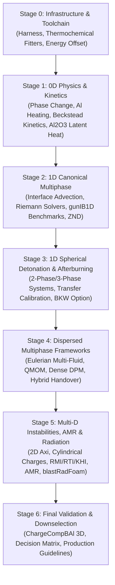

# Master Development Plan: Multiphase Aluminized Detonation & Afterburning Modelling

## 1. Executive Summary & Objective

This master development plan establishes a rigorous, staged program to extend `blastFoam` (OpenFOAM-12) for high-fidelity modelling of aluminized explosive detonation, product expansion, dynamic phase change, aluminium particle dispersion/ignition, and atmospheric afterburning.

- **Ideal Detonation Solver (external)**: The `EuDetCode` C++ library and solver suite is a separate git checkout at `external/eudetcode`, **not tracked by this repository** (neither a submodule nor ignored). The tooling uses its build there: `bin/run_blast_tests.py` Tier 0 (GoogleTest binary `build/tests/eudetcode_tests`; built, 169/169 on 2026-10-13), `tests/1D/verify_planar_znd*.py` (`build/src/DetonationStructure`, `znd_profile.dat`) and `utilities/thermo_fitter/fit_ejwlc_nobleabel.py`. (Until 2026-10-10 these scripts pointed at a non-existent `modules/eudetcode`.) It provides CJ detonation calculations (`CJDetonation`), steady 1D planar ZND / Wood-Kirkwood curved detonation structure (`DetonationStructure`), Hugoniot curves (`HugoniotCurve`), isentropic expansion evaluations, multiple mixture equations of state (THEOSTAR/Exp-6, BKW, JCZ3), and automated JWL fitting with inert phase constraints. It is coupled into the verification and regression toolchains through the paths above.

The plan operationalizes the conceptual roadmap outlined in [`report/plan.txt`](file:///opt/OpenFOAM/blastfoam/report/plan.txt) and builds directly upon the theoretical foundations established in [`report/TBX-blastFoam.tex`](file:///opt/OpenFOAM/blastfoam/report/TBX-blastFoam.tex).



---

## 2. Stage Breakdown & Document Structure

The project is structured into seven dedicated, sequentially executed stages. Each stage is documented in its own detailed action plan. The **Status** column reflects the evidence in the repository on 2026-10-14; see Section 6 and [`status_review_2026-10-14.md`](file:///opt/OpenFOAM/blastfoam/report/status_review_2026-10-14.md) (review against the report aims, with the forward plan).

| Document | Stage Title | Core Focus | Key Deliverables | Status (2026-10-19) |
|---|---|---|---|---|
| [**`stage0_infrastructure_toolchain.md`**](file:///opt/OpenFOAM/blastfoam/report/stage0_infrastructure_toolchain.md) | **Stage 0: Infrastructure & Toolchain** | Automated verification harness, regression testing, `EuDetCode`/`CHEETAH` fitters | Test harness, thermo fitter, EuDetCode coupling | **Partial.** Harness and fitter exist. EuDetCode is a separate checkout (`external/eudetcode`); Tier 0 passes (169/169, 2026-10-13). The case fits were regenerated with the current EuDetCode on 2026-10-13 (D = 7154 m/s, products-only, `utilities/thermo_fitter/products_only_fit.py`). WP 0.3 (BKW/exp-6 tabulation) and the per-step conservation monitor / norms are not implemented. |
| [**`stage1_0d_unit_physics_kinetics.md`**](file:///opt/OpenFOAM/blastfoam/report/stage1_0d_unit_physics_kinetics.md) | **Stage 1: 0D Unit Physics & Kinetics** | 0D reactors, Al thermal ODE, Beckstead combustion, $\text{Al}_2\text{O}_3$ condensation | 0D transfer cases, Al particle kinetics | **Partial.** The 0D transfer tests now run blastEulerFoam (multi-fluid), `phaseTransfer_0D` and `phaseTransfer_0D_3phase` (inert Al): pressure constant to 3e-7 since the 2026-10-13 `E0` recalculation (0.58% before), mass, momentum and total energy conserved (energy to ~5e-9, since the conservative phase decode of 2026-10-12, [`dilute_phase_conservation_plan.md`](file:///opt/OpenFOAM/blastfoam/report/dilute_phase_conservation_plan.md)), with the EuDetCode `T_CJ` and the eJWLC `omegaT` exponent. They meet the WP 1.1 exit criterion $\Delta p/p < 0.01\%$. The isobaric case is missing. Al condensation and high-T air (WP 1.3 now in the solver, below) were standalone numpy models (`tests/0D/verify_*.py`). Since 2026-10-15 (Phase D1, D3) the solver has Al melting (`eMelting` thermo, 0D heating plateau within 0.1% of an independent solution) and ignition at `Tign` with Beckstead burning (`Beckstead` diameter rate, 0D burn times of 1–50 µm within 0.23% of the correlation; the particle mass now follows the diameter, a 1/e mass error of `reactingDiameterModel` fixed); Al2O3 condensation (D4) and the comparison with experiments (D6) are open, and the Comp-B/Al cases do not use the new models yet. High-T air (WP 1.3), staged: (1) done 2026-10-14, JANAF gas extrapolated with constant $C_p$ above its fit range (no dissociation; shocked air up to 14 400 K spherical, 24 800 K planar); (2) NASA-9 thermodynamics to 20 000 K in the solver (`nasa9Thermo`, 18 species incl. O, N, NO, H, OH; done 2026-10-14); (3) equilibrium solver at fixed (e, ρ) (`blastChemicalEquilibrium`, verified against EuDetCode and an independent solution to 20 000 K; done 2026-10-14), (4) local equilibrium above `Teq` in the gas chemistry (done 2026-10-14; spherical cases with `Teq 2500`), (5) the Mach 14 shock in NASA-9 air matches the equilibrium jump within 1.7% (done 2026-10-14), (6) reversible GRI-3.0 H2/O2/CO/C1 mechanism below `Teq`, ignition and burnout within 13% / 0.8% of full GRI-3.0 (done 2026-10-14), (7) nasa9 gas with equilibrium and this mechanism in the reacting spherical cases: shocked air ≤ 9300 K (was 16 500 K), 2 m case to 2 ms (done 2026-10-14); remaining: decode-cap hits of the first mixed cell at breakout, afterburning needs multi-D mixing (`phaseC_highT_equilibrium_plan.md`). |
| [**`stage2_1d_canonical_multiphase.md`**](file:///opt/OpenFOAM/blastfoam/report/stage2_1d_canonical_multiphase.md) | **Stage 2: 1D Canonical Multiphase Numerics** | Riemann solvers, interface advection, planar ZND, `gunIB1D` cross-validation | 1D verification cases | **Mostly complete.** All 4 WPs have cases and verifiers (plus `planar_znd_phaseTransfer`). gunIB1D cross-solver comparison passes again with the rebuilt gunIB1D (2026-10-13): Houim 1 0.000%, Houim 2 within 1.20%, Houim 3 peak pressure 0.59%. The planar ZND verifiers need the EuDetCode build in `external/eudetcode`. WP 2.3: the Loth (2008) compressible/rarefied drag is implemented (`Loth`, 2026-10-15, Phase D2; 0D slip relaxation in both regimes within 0.03% of an independent solution), with the Kavanau rarefaction correction of the Nusselt number (`Kavanau`); the pair Prandtl number used c_v instead of c_p (fixed). Since 2026-10-14 the WP 2.1 shock test runs at Mach 14.5 ($T_2 \approx 10\,000$ K): it matches the jump for the solver's non-dissociating air within 1.2% but fails against equilibrium air ($T_2$ 29% high) until dissociation is implemented. |
| [**`stage3_1d_spherical_detonation.md`**](file:///opt/OpenFOAM/blastfoam/report/stage3_1d_spherical_detonation.md) | **Stage 3: 1D Spherical Detonation & Calibration** | Spherically symmetric 2-phase & 3-phase blast, transfer sensitivity, BKW assessment | Radial blast wave profiles, Kingery-Bulmash validation, phase transfer parameter bounds | **In progress.** Done: `temporalMax`/`temporalIntegral` function objects; C4 `spherical_blast` vs Kingery–Bulmash; inert, reacting and Al-combustion `ChargeCompBAl_1D_spherical*` cases (since 2026-10-13 with the products-only fit and α_Al = 0.182, and Al burning only with gas-phase oxidiser). E1 (2026-10-15): TNT and aluminium-free Comp-B against Kingery–Bulmash with a mesh study (`tnt_blast`, `compB_blast`): overpressure within 3.4% for Z ≥ 4 at 1 mm, 5–8% low at Z 1.5–3; impulse 14–17% (TNT) / 5–9% (Comp-B) low, no afterburning. WP 3.2 sweep started on the 0.2 m case (peaks vary < 3% for 100–200 bar and τ ≥ 1 µs; the aborts with fast transfer were transfer in the burn front, fixed with `lambdaMin`). E2 (2026-10-19, 2 m / 2 ms with the Phase D Al models, burning to oxide with the transported ignited fraction, `setup_e2.py`): the products afterburning adds 2–5% to the peaks, the Al 36–52% beyond 1 m (90–95% burning with air); ignition at 2050 / 932.5 K / 0 gives 66.5 / 80.4 / 80.4% Al burnt at 1.9 ms but peaks within 1%; probably overestimated in 1D. B3 on 2 m: 200 bar within 0.3%, a 2 µs transfer up to 2.3% (peaks), 10% (impulse at 0.3 m). Since 2026-10-16 the Al exchanges drag and heat with the products (`continuousPhases`; before, only with the gas). Open: the overpressure at Z 1.5–3, afterburning in the impulse (needs mixing), Al burning limited by multi-D mixing, long-time 3-phase blast/afterburning runs, WP 3.4 impulse-gain quantification, and the WP 3.5 BKW trial. The products → gas transfer is enabled in `_reacting` and `_alCombustion` since 2026-10-14 (step B1): the products burn with the air. Total energy with a particle phase is conserved since 2026-10-14 (step A6: drag ODE, pressure work on the particle volume, implicit stage): Houim 2 to 6e-7, the spherical cases to 4–7e-4. The test cases end at 40 µs in a 0.2 m domain; the `_alCombustion` setup to 2 m / 2 ms is the tutorial `ChargeCompBAl_1D_spherical_2m` (step B2, 2026-10-15; 0.152 MPa peak overpressure at 1.9 m). |
| [**`stage4_dispersed_phase_modelling.md`**](file:///opt/OpenFOAM/blastfoam/report/stage4_dispersed_phase_modelling.md) | **Stage 4: Dispersed Multiphase Frameworks** | Eulerian vs QMOM vs Dense/Dilute Lagrangian vs Hybrid Handover | High-Mach drag laws, QMOM moment transport, $\epsilon_g$ parcel coupling, dynamic handover | **Not started.** (Only upstream `blastEulerFoam` / `blastParcelFoam` exist; `alphaCutoff` drag added in `6f693f7b`.) |
| [**`stage5_multid_instabilities_amr.md`**](file:///opt/OpenFOAM/blastfoam/report/stage5_multid_instabilities_amr.md) | **Stage 5: Multi-D Instabilities, AMR & Radiation** | 2D axisymmetric charges, RMI/RTI/KHI mixing, LES/RANS, AMR, `blastRadFoam` | Cylindrical charge blast asymmetry, turbulent mixing layer growth, AMR parcel filter kernels | **Started (2026-10-20).** WP 5.1 (G1) accepted with revised criteria: `tests/2D_axi/ChargeCompBAl_2D_axi_spherical` (AMR) overlays the 1D case within 0.74% in arrival and 2.7% in peak, angular variation 10–80° ≤ 3% (peak) / 1.5% (arrival); the 0.5% target is not met (carbuncle of the HLLC at the axis and the symmetry plane, removed by the hybrid HLLC/HLL flux, the default since 2026-10-20; the remaining 1–4% offsets are of the order of the 1D resolution sensitivity). AMR saves 62% of the wall time against the uniform mesh (WP 5.5). G2 met (2026-10-21): `tutorials/blastEulerFoam/ChargeCompBAl_2D_axi_2m` (2 m, to 2 ms, mapped from 1D at 60 µs, finest level decreasing with time) uses 3.7% of the cell-steps of a uniform mesh at the same levels (96% saving; 5.6 h on 6 processes); against 1D arrival within 1.1%, peaks up to 9% and impulse up to 27% higher from stronger afterburning (14% less CO at 2 ms) caused by numerical mixing (the criteria stop refining the products/air mixing layer after 0.2 ms, which then diffuses on the 16 mm cells; a mixing-layer criterion is needed before G3), angular spread of the peaks 1–5%. G2b (2026-10-22): the mixing layer held at 2 mm by a `linearCombination` criterion on the carbon/(carbon + nitrogen) ratio of the gas gives CO burnout within 1% of 1D and peaks within −3 / +4% to 1.3 ms (18 h, 5% of the cell-steps of a uniform 2 mm mesh); mesh-seeded Rayleigh–Taylor fingers from 0.5 ms; the inward secondary shock runs ahead along the axis and the symmetry plane (air into the fireball on the axis, products jet along the plane). Axis study (2026-10-23, uniform 8/4/2 mm cells): grid-seeded, the mesh aligned with the axis turns the flow towards it, the pressureless Al accumulates in the small axis cells and drag carries the error to the gas; first order in the axis column (4.6/2.1/1.1%), not converged within ~25° of the axis, so the 0°/90° rays are mesh-dependent. G3a (2026-10-23): cylinder tutorial `ChargeCompBAl_2D_axi_cylinder`; L/D 1 and 4 parked on 2026-11-01 at 267 µs and 173 µs for continuation elsewhere. Early comparison: end-on 2.1–2.6 times the sphere, side-on 1.0–1.6, 0.5–0.6 at 30–60° (`stage5_g3_plan.md`). Literature check (2026-11-01) against the centre-initiated TNT studies of Gao et al. (2022) and Xiao et al. (2020): agreement in the angular pattern (axis strongest at small Z, vertex minimum) and within the spread of the two studies; L/D 4 against Gao's fit at 0.3 m: side-on 1.04 (0.81), axis 2.55 (2.37), 45–60° 0.52–0.59 (0.49–0.64). The side-on rise with L/D appears only beyond Z ≈ 0.7, which the parked runs have not reached. G3b (started 2026-11-01): seeded-contact tutorial `ChargeCompBAl_2D_axi_seeded`; a 3 mm n = 24 mode seeded at 60 µs first dropped to 43%, then grew again (e-folding about 55 µs from 100 µs); seeded at 200 µs (6 mm, run to 1.3 ms, 2026-11-02) the mode grew to 113 mm (e-folding about 200 µs to 0.6 ms, then linear and nonlinear), the mixing width became 22% larger than unseeded, and the CO burnout stayed the same within 0.1 g (the burning stops as the gas cools, not for lack of mixing surface); the 60 µs / 1 mm-layer and seeded-charge variants are set up for a larger machine. G3c (started 2026-11-02, 1D 2 m case to 0.5–1.3 ms): k-omega SST on the gas is identical to laminar (no shear in 1D; spurious ν_t of 0.4–1.3 m²/s produced at the secondary shock, 2–3e-4 m²/s at the contact); PaSR with the RANS mixing time and the new cell-size mixing time (`mixingTime delta`, Δ²/(ν_eff + ν_sgs) with Smagorinsky ν_sgs) both suppress the afterburning in the numerically mixed cells (median κ 1e-6–1e-3 early; no CO burnt after the peak against 7 g laminar; peaks −1.2 to −2.1%, impulse −3 to −5.5% at 0.3/0.5 m). The afterburning is bounded by the laminar and the PaSR limit; the 2D comparison is next. Report sections on G3a–G3c added to `TBX-blastFoam.tex` (2026-11-03). (No `blastRadFoam`; the axisymmetric `tutorials/blastEulerFoam/ChargeCompBAl` uses the Stage 3 settings since 2026-10-14; its floating-point exception (116 µs) was a sign error in the residual stabilisation of the upstream fluid phase equations, fixed 2026-10-14; a run restarted from 170 µs then reached 200 µs; on 2026-10-19 a complete run from 0 with 30 µm Al and all fixes reached 200 µs on 6 processes.) |
| [**`stage6_validation_methodology_downselection.md`**](file:///opt/OpenFOAM/blastfoam/report/stage6_validation_methodology_downselection.md) | **Stage 6: Final Validation & Downselection** | Full 3D `ChargeCompBAl` validation, decision matrix, production guidelines | Validated full-system solver, downselection scoring matrix, user manual additions | **In progress** (handoff to a larger machine: [`handoff_2026-11-16.md`](file:///opt/OpenFOAM/blastfoam/report/handoff_2026-11-16.md)). H0 (2026-11-03, [`h0_dataset_survey.md`](file:///opt/OpenFOAM/blastfoam/report/h0_dataset_survey.md)): no open Comp-B/Al dataset; the free-field scatter (±6–8%) exceeds the laminar/PaSR difference (1–5% in 1D), so the data test the Al effect, not the mixing closure. H1 case: Pontalier et al. (2021), gelled NM with Al or glass, about 1 kg spheres; secondary Trzciński et al. (2007), RDX/Al at 2 m; H-6 TNT equivalences when DTIC is reachable. FOI June 2013 TNT and TNT/Al shots (raw data retrieved, extracted in `tutorials/blastEulerFoam/FOI2013_TNT_1D_spherical`) are now the primary dataset: repeat shots agree to 3% in impulse at 4-6 m, Al adds 15-27%. Pontalier trials 0 and 6 (1D, laminar) done: arrival within 3% for trial 0, the trial 6 enhancement (11% earlier, 65% higher peak at 2 m) only 2% / 16% in the model; PaSR and trial 18 paused. FOI shot 4 1D (laminar, PaSR) done. 2D shot 4 laminar (ground, AMR 32 mm base with 8 mm finest, old C(gr) treatment, mapped from 1D at 1.5 ms, to 18 ms, 45 h on 6 processes) done 2026-11-10: arrival at P1/P2/P3 (2/4/6 m) +5.4/+2.2/+0.5%, peaks −63/−35/−23%, impulse +26/−10/−15%, positive duration at P2/P3 within 3%. The P1 measurement (441 kPa, 0.7 ms) is doubtful: the incident shock there is about 74 kPa (1D and Kingery–Bulmash) and the regular reflection at 45° about 160–190 kPa, as modelled; the data note P1 ringing. 1D resolution test (2026-11-11, uniform 8/4/2 mm cells, 7 m, mapped from the 1D run at 1.5 ms): at the slant distances of P1/P2/P3 (2.83/4.47/6.33 m) the 8 mm peaks are 6.2/6.0/5.9% below 2 mm (4 mm 2.3-2.5%; extrapolated, 8 mm is 7-10% low), impulse within 0.2% and arrival within 35 µs on all meshes, so 8 mm would explain only a small part of the 2D peak deficit (−35/−23%) and none of the impulse deficit. Diagnosis (2026-11-11): the 2D shock was not at 8 mm: the `scaledDelta` criteria on p and rho (`lowerRefineLevel 0.2`) stop flagging the shock once it is weak and smeared, and from about 2.5 m (3 ms) it runs on the 32 mm base cells; the 2D free-field peaks along the charge height (y = 2 m) are 64/28/16 kPa at 2.83/4.47/6.33 m, 20% below 1D at 2 mm (80/35/20 kPa; Kingery–Bulmash for 0.94 kg TNT 88/37/21 kPa). The 2D ground/free-field ratios are 2.6/2.3/2.2 against 5.5/2.8/2.2 in the measurement. 1D on uniform 32/16 mm cells gives 62.6/28.3/16.3 and 69.9/31.3/18.0 kPa, so the 2D free field matches the 32 mm 1D run (within 2%): the 2D peak deficit is mainly the unrefined shock. Scaled to the 2 mm free field, the 2D ground peaks would be about 81/44 kPa at P2/P3 (measured 100/45). 2D rerun with refinement at absolute pressure jumps (`setup_foi2013_2d.py --pressureDelta 2000`, 2026-11-13, 45 h): free-field peaks at 2.5/3 m within 3% of the 8 mm 1D run; ground peaks at P1/P2/P3 200.5/74.8/39.5 kPa (before 164.4/64.6/34.8; measured 440.9 (doubtful)/99.9/45.1), so P2/P3 −25/−12%, against the 10–11% repeat-shot peak scatter; impulse 122.4/72.2/48.5 Pa s, unchanged (P2/P3 −7/−15%, scatter 3%), arrival +8.9/+3.3/+1.7% (about 0.1–0.2 ms later than the first run), positive duration at P2/P3 within 1%. The remaining peak deficit at P2 and the impulse deficit growing with distance are not resolution. Afterburning (2026-11-13): the 2D laminar run burns 0.5% of the combustion potential of the products fuel (CO, C(gr), H2; 8.9 MJ for the charge, 2.3 times the detonation energy e0·m = 3.8 MJ) by 18 ms, 46 kJ; no fuel lies in cells with more than 2% O2 at any time (the few mixed cells are at about 2100 K and burn), so the burning is limited by mixing: the 4 mm mixing layer stays sharp and the gas has no subgrid species diffusion. PaSR cannot change that (κ ≤ 1 scales the laminar rate down, as in G3c), so the 1D PaSR rerun was stopped. Energy sensitivity in 1D (7 m, 8 mm cells, energy added to the products gas at fixed density and composition, mapped from the laminar 1D run; each set against its own baseline): +10–30% of e0·m at 1.5 ms changes nothing in the positive phase at 2.83/4.47/6.33 m (the fireball wave arrives after it ends); +10/20% at 0.3 ms gives impulse +2.6–2.8/+5.1–5.4%, peak +1.9–2.2/+3.8–4.5%, arrival −0.03–0.05/−0.05–0.09 ms; +20% at 0.6 ms impulse +4.5–4.7%. About 0.25% impulse per 1% of e0·m released before about 0.6 ms, the same at all three distances. Closing the 2D deficits would need about +25–30% (P2 impulse), +55–60% (P3 impulse) and +45% (P3 arrival) of e0·m, i.e. 11–26% of the combustion potential burnt within about 0.6 ms; the growth of the impulse deficit from P2 to P3 is not explained by energy. The shot 4 pyrometer maximum is 1135 °C at 20.3 ms (fireball mass mean in 2D about 550 °C at 18 ms). Next: literature on early TNT afterburning in free air, the 2D ground/free-field ratios against the measurement, then subgrid mixing (turbulent species diffusion, LES) if early afterburning of that size is plausible. Ground reflection and free field (2026-11-13): the 2D Mach stem is at level 2 (8 mm) over its height (0.1–0.2 m at P2, 0.2–0.3 m at P3), and the 2D peak above it at 6 m (19.5 kPa) matches 1D; the 2D ground impulse equals the sum of the 1D free-field impulses at the direct and image distances at P3 (48.5 against 48.9 Pa s) and is 11% above it at P2 (stronger reflection), so the ground reflection is not the cause. Against Kingery–Bulmash free air for 0.94 kg TNT (`tests/1D_spherical/kingery_bulmash.py`; impulse derived from the hemispherical fit), the 1D free-field impulse is 20/18/16% low at 2.83/4.47/6.33 m (peak 15/10/8% low on 8 mm cells, about 6% less on 2 mm), and the KB direct + image impulse sum reproduces the measured P2/P3 impulse within 1% (78.7/57.9 against 77.8/57.3 Pa s). The measurement is therefore consistent with KB and the deficit is in the free field, nearly uniform with distance as for missing energy; the growth of the 2D ground deficit from P2 to P3 comes from the P2 reflection. At about 0.25% impulse per 1% of e0·m, closing it would need roughly 65–80% of e0·m released early (an extrapolation), or a higher detonation energy than the fitted e0 4.07 MJ/kg: to be checked against measured TNT detonation energies and early afterburning in the literature. The 1D outer boundary does not affect this: 16 mm runs on 7 and 14 m domains give identical arrival, peak and impulse at 2.83/4.47/6.33 m. The impulse deficit matches the 14–17% of the 1D TNT runs without afterburning (E1). Energy and products EOS (2026-11-14): the model heat of detonation (reactant energy Cv·T0 + e0 minus the transferred products' gas energy at 298 K) is 4.45 MJ/kg with gaseous water (4.76 with liquid water), against the measured 4.57 MJ/kg (Ornellas, presumably liquid water) and Cheetah 4.74 MJ/kg, so e0 is not low. Early release (1D, R = 4 m, cells as the laminar 1D run, restarted at 0.1 ms with a coded heat source in the gas energy spread by the products mass, within 2.5% of the target energy): +20% of e0·m over 0.10–0.12 ms gives impulse +6.0/+6.3/+7.6% at 2.0/1.5/1.0 m (peak +7.7–9.5%), over 0.10–0.50 ms +4.6/+4.8/+6.2%; about 0.3% impulse per 1%, as at 0.3 ms, so earlier release does not remove the 65–80% estimate (the 4 ms runs end inside the positive phase at 2.5–2.83 m). The products isentrope (`eJWLC` to the 100 bar transfer, then the frozen Abel–Nobel/nasa9 gas) does 2.3% less work from CJ to 1 atm than the EuDetCode BKW isentrope (∫(p − p0) dv 5.49 against 5.63 MJ/kg; 3–4% less at 100–1000 bar), with no pressure jump at the transfer (gas at 902 K and 100.0 bar at the products' density and energy): about −0.6% impulse, not the cause. Waveforms at P2/P3 against the measurement (aligned at the shock): the 2D positive duration (2.61/3.07 ms) and decay match (2.60/3.04 ms); the impulse deficit (5.3/8.4 Pa s) comes at P2 from the sharp measured peak (1.7 Pa s in the first 0.3 ms) and a shoulder at 0.5–1 ms, at P3 entirely from 0.75–2.5 ms, where the measurement has humps at about 0.6, 0.9, 2.0 and 2.3 ms after arrival that the smooth model decay lacks. The humps appear at the same delays in all TNT shots (HOB 0.15–2 m) and shot 5, so they are not the ground reflection: candidates are the top booster (the model initiates at the centre), fireball reverberation, or site/gauge-mount reflections. The measured secondary shock arrives 3.0–3.8 ms after the main shock (TNT; 2.1 ms TNT/Al), sharp, against a weak bump at about 4.8 ms in the model. Against this measurement the model positive phase is not short, unlike against KB (E1: 13–23% shorter), and the KB free-air impulse depends on its hemispherical-to-free-air conversion (mass factor 1.66 at 2.83 m; 1.8 gives −5%, 2 gives −11%). Booster initiation (2026-11-16) does not explain the deficit or the humps. Setup: 2D free field from the detonation (no ground, chemistry off, 2 mm at the charge, 8 mm products mixing layer from 1.0/0.75 ms, end 4.5 ms), initiation at the centre or at the booster (on the axis 34 mm above the centre). Centre initiation is isotropic within 1.2% in arrival and 4.7% in peak and arrives 0.7-2.4% after 1D. Booster minus centre:
- **Near the charge:** the effect is strongly directional, with impulse over 1.5 ms from -15% (up) to +126% (down) at 0.5-1 m.
- **From 1.5 m, at the gauge angles -18 to -45°:** I+ changes by -2.1 to +2.0%, the peak by -3 to +4%, arrival by 7-50 µs earlier, and t+ is unchanged.
- **Waveforms:** they coincide apart from small ripples present in both, and neither has humps at 0.6/0.9 ms after arrival. The secondary shock comes 0.1-0.2 ms later at 1-1.5 m. Literature on early TNT afterburning (2026-11-16): early afterburning of the needed size is plausible and limited by mixing. Balakrishnan et al. (2010, 3D DNS of a 1.4 kg TNT sphere, mixing-limited chemistry) burn about 6.5/10.6/14% of the combustion potential by 0.3/0.6/1 ms and raise the positive impulse by +60/+46% at Z = 0.80/1.38 m/kg^1/3 over 1D (primary shock unchanged, earlier and stronger secondary shock). Barometric calorimetry (LLNL, air against N2) gives +12% (C-4) and +19% (an HME) in the first positive impulse; Tyas et al. (2016, PETN) 15–20% lower reflected impulse in N2. Subgrid mixing model (2026-11-16): fvModel `turbulentMixingDiffusion` (UPDATES 2.2; test `tests/1D/turbulentMixingDiffusion`: erfc solution within 2e-4, conservative, masked outside the layer), species and energy diffusion in the products/air layer with D = C w dw/dt from the Balakrishnan widths. Shot 4 1D (R = 4 m, cells as the laminar 1D run) with C = 0.005/0.01/0.03 (C = 0.1 stopped, 47% burnt by 0.5 ms, shock ahead of the baseline), interim at about 1.5–1.8 ms: burnt (by O2 consumption) 15.8/23.6/43.0% against 5.6% laminar (numerical mixing); C = 0.005 follows the Balakrishnan history scaled to the charge (15.0% at 1.15 ms, levelling off). Impulse at 0.75 m (positive phase over) +12/+23/+51%, peak +1/+2/+8%. At the calibrated burn the 1D gain is about a fifth of Balakrishnan's 3D gain; reaching it takes about three times their burn and raises the peaks, so most of their gain appears to be multi-D flow, not the burn itself. Runs to 3 ms (1.5 m and the Z = 1.38 probe) pending, then the calibrated C on the 7 m / 8 mm case at 2.83/4.47/6.33 m. 2026-11-08: the TNT products were far too cold (C(gr) as a gas in the Abel-Nobel EOS, fireball 200-320 K at 0.1 ms); condensed species (`condensed yes`, UPDATES 1.2a-1) give a transfer temperature of 902 K (614 K), on the EuDetCode isentrope within 5%; FOI shot 4 1D laminar rerun with it (2026-11-10): blast within 1% in peak and 0.5% in impulse from 0.5 m (impulse +8-17% at 0.15-0.3 m), products 250-300 K hotter (750-880 K mean), afterburning negligible in 1D laminar with either treatment (0.6% of the fuel), so the 2D shot 4 run (old treatment) remains usable for the blast; afterburning-sensitive runs (PaSR, Al) need rerunning. Before: the 2D case with the ground (`tutorials/blastEulerFoam/FOI2013_TNT_2D_axi_ground`; `run_foi2013.sh`/`run_campaign.sh` run the 1D and 2D chain for all shots on another machine). |

---

## 3. Core Physics & Numerical Architecture

### 3.1 Thermodynamic Reconciliation Across Phase Boundaries
The simulation transitions from a condensed detonating phase governed by high-pressure Mie-Grüneisen equations of state ([`eJWLC`](file:///opt/OpenFOAM/blastfoam/src/thermodynamicModels/specie/equationOfStates/equationOfStates/eJWLC)) to an expanding reactive multicomponent gas governed by the Noble-Abel co-volume equation of state (named [`AbelNobel`](file:///opt/OpenFOAM/blastfoam/src/thermodynamicModels/specie/equationOfStates/equationOfStates/AbelNobel) in the code). Mass transfer between them is handled by the [`pressurePhaseChange`](file:///opt/OpenFOAM/blastfoam/src/thermodynamicModels/fvModels/pressurePhaseChange) fvModel:

$$\text{eJWLC}: \quad p(\rho, e) = p_s(V) + \omega \rho \left(e - e_s(V)\right)$$

$$\text{Noble-Abel}: \quad p(\rho, T) = \frac{\rho R_{\text{mix}} T}{1 - b_{\text{mix}} \rho}$$

To eliminate artificial pressure and temperature discontinuities at the phase transfer threshold ($p_{\text{trans}} \approx 100\text{--}200\,\text{bar}$), the general four-step matching formulation must be enforced:
1. Continuous transition temperature evaluation: $T_{\text{trans}} = \frac{p_{\text{trans}}(v_{\text{trans}} - b_{\text{mix}})}{R_{\text{mix}}}$.
2. Reference energy offset calculation: $E_0 = e_{\text{sensible, gas}}(T_{\text{trans}}) - e_{s,\text{eJWLC}}(V_{\text{trans}})$.
3. Asymptotic tail calibration ($C^1$ continuity): $\omega_{\text{JWL}} = \gamma_{\text{mix}}(T_{\text{trans}}) - 1$ and $C = p_{\text{trans}} V_{\text{trans}}^{\omega_{\text{JWL}} + 1}$.

*Implementation status:* `pressurePhaseChange` is verified in 0D and planar ZND but is disabled in all Comp-B/Al spherical cases and tutorials (`constant/fvModels.disabled`). The matching is applied offline by the fitter [`utilities/thermo_fitter/fit_ejwlc_nobleabel.py`](file:///opt/OpenFOAM/blastfoam/utilities/thermo_fitter/fit_ejwlc_nobleabel.py), which produces the case coefficients. At run time, `pressurePhaseChange` applies no state-dependent energy correction (only an optional constant `eOffset` datum shift), so the transfer is energy-conservative and pressure continuity relies on the `E0` calibration. Temperature consistency at the transfer state is set through the eJWLC `omegaT` exponent (report Section 3.3.4).

### 3.2 Aluminium Aerodynamics, Ignition & Multi-Oxidizer Combustion
Aluminium particles in the blast environment experience extreme relative Mach numbers ($\text{Ma}_p > 1$), requiring compressible drag models (Henderson / Carlson-Hoglund) spanning continuum and free-molecular regimes:

$$\frac{d\mathbf{u}_p}{dt} = \frac{3}{4} \frac{\rho_g C_{D,\text{comp}}(\text{Re}_p, \text{Ma}_p)}{\rho_p d_p} \|\mathbf{u}_g - \mathbf{u}_p\| (\mathbf{u}_g - \mathbf{u}_p) + \mathbf{g}$$

Thermal evolution incorporates melting latent heat buffering at $T_{\text{melt}} = 933\,\text{K}$ ($\Delta H_{\text{fus}} = 397\,\text{kJ/kg}$) and oxide shell passivation breakdown at $T_{\text{ign}} \approx 2050\text{--}2300\,\text{K}$. Subsequent burning follows a generalized $d^n$ law with multi-oxidizer effective mole fractions:

$$\frac{d(d_p)}{dt} = -\frac{2 K_{\text{comb}}}{\rho_p d_p^{n-1}} \left(X_{\text{O}_2} + 0.6 X_{\text{H}_2\text{O}} + 0.22 X_{\text{CO}_2}\right)^{0.9} \left(1 + 0.276\,\text{Re}_p^{1/2}\text{Sc}^{1/3}\right)$$

Post-combustion condensation of alumina vapour ($\text{Al}_2\text{O}_{3(\text{g})} \to \text{Al}_2\text{O}_{3(\text{s})}$) releases $\sim 19\,\text{MJ/kg}$ of latent enthalpy, maintaining fireball temperatures and driving late-time blast overpressure.

*Implementation status:* none of the Section 3.2 models is implemented in the solvers yet.
- The compressible drag laws, melting latent heat, ignition, $d^n$ burning and alumina condensation exist only in the standalone numpy model [`tests/0D/verify_al_particle_kinetics.py`](file:///opt/OpenFOAM/blastfoam/tests/0D/verify_al_particle_kinetics.py).
- The CFD cases use the existing drag models in `applications/modules/blastEuler/interfacialModels/dragModels/` (none Mach-dependent).
- Particle burning in the CFD cases uses the empirical pressure-based burn rate `src/diameterModels/reactionRates/pressureBased/` ($r_b = a\,p^n$), plus gas-phase Al reactions (`tests/1D_spherical/ChargeCompBAl_1D_spherical_alCombustion`).

---

## 4. Test Case Hierarchy (0D $\to$ 1D $\to$ 2D $\to$ 3D)

Planned hierarchy is shown below. Actual cases (2026-10-14) are mapped in the table that follows it.

```
tests/
├── 0D/
│   ├── phaseTransfer_isochoric/        # Machine Delta p = 0, Delta E = 0
│   ├── phaseTransfer_isobaric/         # Enthalpy and species fraction mapping
│   ├── al_heating_laser_ignition/      # Particle thermal ODE, melting plateau
│   ├── al_combustion_bomb/             # Beckstead constant-V/constant-P bomb
│   ├── highT_air_dissociation/         # NASA-9 polynomials up to 6000 K
│   └── alumina_condensation_box/       # Latent heat coupling & temperature locking
├── 1D/
│   ├── shock_dissociating_air/         # High-Mach shock speed and post-shock T
│   ├── multiphase_contact_advection/   # Non-oscillatory alpha advection
│   ├── riemann_dense_particulate/      # gunIB1D / Lowe & Houim shock tube
│   ├── planar_znd_detonation/          # CJ state and VN spike verification
│   ├── spherical_detonation_2phase/    # JWL + air expansion vs Kingery-Bulmash
│   ├── spherical_detonation_3phase/    # JWL + Al + air inert/reacting comparison
│   └── spherical_detonation_bkw/       # Single-EOS continuous equilibrium trial
├── 2D_Axi/
│   ├── spherical_symmetry_repeat/      # Multi-D symmetry preservation check
│   ├── cylindrical_charge_aspect_ratio/# L/D = 0.5, 1.0, 2.0, 4.0 shock focusing
│   └── turbulent_mixing_layer_rmi_rti/ # Resolved contact discontinuity instabilities
└── 3D/
    ├── ChargeCompBAl_inert/            # Baseline 3D inert Al blast
    └── ChargeCompBAl_reacting/         # Full coupled multi-D production case
```

| Planned | Actual (2026-10-14) |
|---|---|
| `0D/phaseTransfer_isochoric` | `tests/0D/phaseTransfer_0D`, plus `tests/0D/phaseTransfer_0D_3phase` (inert Al); blastEulerFoam since 2026-10-10 |
| `0D/phaseTransfer_isobaric` | Missing |
| `0D/al_heating_laser_ignition`, `al_combustion_bomb`, `alumina_condensation_box` | No solver cases; numpy model `tests/0D/verify_al_particle_kinetics.py` only |
| `0D/highT_air_dissociation` | No solver case; numpy model `tests/0D/verify_highT_air_thermo.py` only |
| `1D/shock_dissociating_air` | `tests/1D/shock_dissociating_air` |
| `1D/multiphase_contact_advection` | `tests/1D/multiphase_advection` |
| `1D/riemann_dense_particulate` | `tests/1D/gunib1d_houim1`, `gunib1d_houim2`, `gunib1d_houim3` |
| `1D/planar_znd_detonation` | `tests/1D/planar_znd`, plus `tests/1D/planar_znd_phaseTransfer` |
| `1D/spherical_detonation_2phase` | Closest: `tests/1D_spherical/spherical_blast` (blastFoam, C4 JWL → air, not Comp-B/Al) |
| `1D/spherical_detonation_3phase` | `tests/1D_spherical/ChargeCompBAl_1D_spherical`, `_reacting`, `_alCombustion`, `_interface` (blastEulerFoam; R = 0.2 m, 40 µs; products → gas transfer disabled) |
| `1D/spherical_detonation_bkw` | Missing |
| `2D_Axi/spherical_detonation_3phase` | `tests/2D_axi/ChargeCompBAl_2D_axi_spherical` (G1, AMR, 6 processes; overlay on the 1D case) |
| `2D_Axi/*` (others), `3D/*` | Missing (2D-wedge setups exist as tutorials: `tutorials/blastEulerFoam/ChargeCompBAl`, `tutorials/blastFoam/axisymmetricCharge*`) |

The regression runner [`bin/run_blast_tests.py`](file:///opt/OpenFOAM/blastfoam/bin/run_blast_tests.py) defines 18 tests: Tier 0 = 2, Tier 1 = 5 (including both 0D transfer cases), Tier 2 = 6, Tier 3 = 5 (including the stationary charge/air interface). The most recent committed `blast_test_report.md` (`6f693f7b`, 2026-10-05) contains only a Tier 0 run. Since 2026-10-14 the solver-based verifiers fail if the solver log has no `End`.

---

## 5. Risk Management & Decision Gates

| Milestone | Gate Criteria | Fallback Strategy | Status (2026-10-19) |
|---|---|---|---|
| **Gate 1 (End of Stage 1)** | 0D reactor energy and pressure error $< 10^{-6}$; Al ignition delay within 5% of shock tube/bomb data. | Refine $E_0$ offset iteration and calibrate single-particle convective Nusselt correlations. | **Not met.** Energy conserved to ~5e-9 (blastEulerFoam); pressure deviation 3e-7 (target $10^{-6}$; met for both 0D transfer tests since 2026-10-13). Ignition delay has not been compared with experimental data. |
| **Gate 2 (End of Stage 2)** | 1D multiphase Riemann wave speeds and density plateaus match `gunIB1D` reference solutions within 2%. | Switch to AUSM+ or flux-split KT with refined slope limiters (van Leer / Minmod). | **Met (2026-10-13).** With the rebuilt gunIB1D: Houim 1 0.000%; Houim 2 transmitted shock speed 1.20%, post-shock pressure 0.42%, gas velocity 0.67% (solid velocity 2.09%, not part of the check); Houim 3 peak pressure 0.59%. blastEulerFoam Houim 3 compaction speed 183.8 m/s vs 185.25 m/s reference (0.8%) since `alphaDeltaMin` 1e-6. The earlier "within 0.02%" (`0a181853`) compared gunIB1D with the Houim reference, not blastEulerFoam with gunIB1D. |
| **Gate 3 (End of Stage 3)** | 1D spherical blast overpressures match Kingery-Bulmash TNT equivalent within 5% for inert baseline. | Re-tune JWL isentrope fitting range ($V/V_0 \le 20$) and adjust Noble-Abel co-volume $b_{\text{mix}}$. | **Partly met (2026-10-15, E1).** 1 kg TNT (EuDetCode products) with 1 mm cells: within 3.4% of the Kingery–Bulmash free-air overpressure for Z ≥ 4, 5–8% low at Z 1.5–3; Comp-B (2 mm, TNT equivalence 1.11) within 4% for Z ≥ 4, 8% for Z 1–3. The overpressure converges with the resolution of the charge (4 mm: 5–15% low). Positive impulse 14–17% low for TNT, 5–9% for Comp-B (short positive phase; no afterburning). `tests/1D_spherical/tnt_blast`, `compB_blast`. Earlier: Peak overpressure error is 10–20% (C4 case, not the Comp-B/Al inert baseline). `tests/1D_spherical/verify_kingery_bulmash.py` passes on looser impulse limits (40% per station, 15% at Z = 2), and its 25% overpressure check is not part of pass/fail. |
| **Gate 4 (End of Stage 4)** | Quantitative scoring of Eulerian, QMOM, Lagrangian, and Hybrid schemes on identical 2D blast clouds. | Downselect the leading method (or Hybrid approach) for all multi-D cases in Stage 5/6. | Not reached. |
| **Gate 5 (End of Stage 6)** | Full 3D `ChargeCompBAl` peak overpressure, arrival time, and positive impulse match experimental gauge data within 8%. | Perform sensitivity analysis on subgrid turbulent mixing timescale $\tau_{\text{mix}}$ in PaSR/EDC. | Not reached. |

---

## 6. Progress Notes

- The stage documents `report/stage*_*.md` were written in `4cb49946` (2026-10-01). Their status sections were corrected on 2026-10-14 for Stages 1 and 2 (WP 1.3 extended); their work-package descriptions are the original plan. Where they disagree with the Status column above, the Status column is current.
- `report/TBX-blastFoam.tex` stage labels, the EuDetCode description and the Stage 1 phase-transfer results were brought in line with this status on 2026-10-10.
- Stage-document paths that do not exist in the code: `src/fvModels/pressurePhaseChange/` (actual: `src/thermodynamicModels/fvModels/pressurePhaseChange/`), `src/combustionModels/blastCombustionModel/`, `src/lagrangian/intermediate/`, `tests/common/`, `src/thermodynamicModels/derived/bkwThermo/`.
- (2026-10-12) The blastEulerFoam phase decode is now conservative: the dilute-phase resets are removed, the granular buoyancy term uses the mixture pressure, and dilute fluid phases are kept near pressure equilibrium by a conservative volume exchange. A stationary charge/air interface test was added (Tier 3). The spherical air shock is now earlier and stronger than with the resets, which deleted the energy of the products expanding into the air. The Stage 3 report numbers and figures were regenerated. Open: pressure relaxation in non-dilute mixed fluid cells, and the gas `residualRho` floor. See [`dilute_phase_conservation_plan.md`](file:///opt/OpenFOAM/blastfoam/report/dilute_phase_conservation_plan.md).
- (2026-10-13) The fluid decode no longer bounds the density below by `residualRho`, which held expanded gas at 1.2 kg/m³: the spherical air shock at 10 cm is now 14 MPa (0.16 GPa with the floor). `alphaDeltaMin` was reduced so the frictional stress limits packing (`houim3` 1e-6, Comp-B/Al cases 1e-3). The reacting-diameter `d0` field is now mapped under AMR (fixes its crash at 2.6e-7 s; the tutorial still fails near 2.7e-4 s with a collapsing time step, as with the original decode). Checked new vs HEAD: `gunib1d_houim1-3`, `validation/blastEulerFoam/shockTube_{dilute,dense,bidisperse}` and `shockTube_polydisperse` run to completion with both.
- (2026-10-13, later) The inert and reacting Comp-B/Al cases and the 1D tutorials relax numerically mixed products/air cells to pressure and temperature equilibrium (`alphaDilute 1` plus a stiff products/gas heat transfer). `_alCombustion` followed on 2026-10-14, after the interface fix.
- (2026-10-13, last) Fits regenerated with the current EuDetCode (D = 7154 m/s, p_CJ = 20.15 GPa; `utilities/thermo_fitter/products_only_fit.py`), with an `E0` on the blastFoam gas energy convention: the 0D transfer is now pressure- and temperature-continuous. The granular Al energy equation now includes the compression (cold) energy and no longer advects kinetic energy into the thermal energy (Al stays at 288 K under compression instead of cooling to 100 K). The instant velocity relaxation and the drag work are energy-conservative. `_interface` passes at 5 µs; beyond it the interface can still become unstable (trace-phase face fluxes, UPDATES.md Section 7).
- (2026-10-14) Charge/air interface instability fixed: in the HLLC flux of a fluid phase that is a trace on one side of a face, that side now takes the mixture impedance (`alphaTrace 1e-3` in the Comp-B/Al cases). `_interface` stays at rest for 40 µs (≤ 1.4 mm/s); the inert, reacting and Al-combustion cases give 16.61 GPa in the charge and 3.3–3.5 GPa at breakout.
- (2026-10-14, later) The blastEulerFoam Comp-B/Al tutorials use the test-case settings (JANAF/Abel–Nobel air instead of ideal-gas air; relaxation settings in the 2D case); the blastFoam Comp-B/Al tutorials were removed. The JANAF gas is extrapolated with constant $C_p$ above its 5000 K fit range (gas `THigh 50000`), which the planar tutorial needs; the spherical air shock is now 47 / 35 MPa at 80 / 100 mm (44 / 29), breakout 3.05 GPa. Next for the gas: NASA-9 thermodynamics to 20 000 K and O2/N2 dissociation chemistry (WP 1.3, see Stage 1 status).
- (2026-10-14, review) Status reviewed against the report aims ([`status_review_2026-10-14.md`](file:///opt/OpenFOAM/blastfoam/report/status_review_2026-10-14.md)): only the detonation and early expansion phase is represented in the solver runs; products/air chemistry, Al ignition/combustion and afterburning are not (transfer disabled, Al models numpy only, 0.2 m / 40 µs domains). The review gives a phased plan (A consolidate, B products → gas transfer, C high-T air, D Al physics in the solver, E 1D validation, F dispersed method, G multi-D, H validation). Phase A started: stage documents corrected (WP 1.2–1.5 marked model-only, Stage 2 results), verifiers check that the solver finished, the `_reacting` verifier checks for heat release. The inert vs reacting U_Al difference (2303 vs 1890 m/s) comes from the drag settings: `_reacting` has `solveDragODE on` and `alphaCutoff 1e-3`, so drag on the dilute Al leading edge is cut off.
- (2026-10-14, report) `TBX-blastFoam.tex` restructured: modelling framework with the multi-fluid equations; provenance of each capability (upstream `blastFoam` at `71b97fd7` vs this work, Table 1 and [upstream]/[this work] marks); separate verification approach and results sections with one test table; status against the aims and the plan. Overstated claims removed (numpy-only models, dissociation, Kingery–Bulmash agreement: peak overpressure 10–21% low, impulse 3–32%); upstream tutorials not assessed in this work moved to an appendix. 21 pages (was 36).
- Per-commit change details: see [`UPDATES.md`](file:///opt/OpenFOAM/blastfoam/UPDATES.md).
